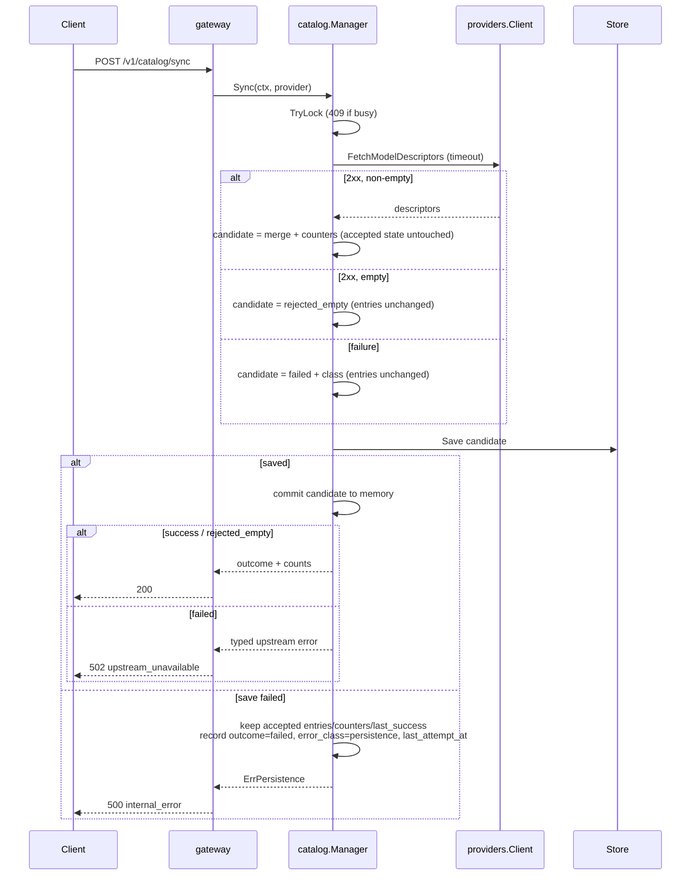

# E03 — Model Catalog — Technical Design

Status: approved by the developer (2026-10-30); amendment A1 approved and
reflected in SPEC rev 5. Companion to
`docs/specs/E03-model-catalog.md` (rev 5). Decisions: ADR-009 and ADR-010.

This document defines components, responsibilities, contracts, flows, failure
handling, test seams and the implementation plan. It contains signatures and
pseudocode for design purposes only; no production code or test code exists yet.

## 1. Goals and constraints

- Implement SPEC E03 rev 4 exactly; no additional behavior.
- Go 1.23, standard library only, no new dependency.
- E01/E02 remain untouched: `GET /v1/models` keeps its byte-for-byte
  passthrough, `/v1/responses` and `/diagnostics/providers` keep their shape.
- Catalog synchronization never affects `/readyz`.
- Local-first, modular monolith, explicit module lifecycle, no routing/ranking.
- The catalog is derived data: losing it must never break startup or serving.

## 2. Architecture overview

```mermaid
flowchart TB
    subgraph cmd["cmd/ai-hub"]
        MAIN[main.go<br/>wiring + routes]
    end

    subgraph modules["app.Module order"]
        PROV[providers.Manager<br/>E02 state machine]
        CAT[catalog.Manager<br/>load, sync, query]
    end

    subgraph transport["internal/server + gateway"]
        SRV[http.Server / Router]
        GH[catalog handlers]
        GE[E02 handlers<br/>responses, models, diagnostics]
    end

    subgraph data["internal/catalog"]
        DOM[domain<br/>ModelEntry, CapabilityClaim, View]
        STORE[Store<br/>versioned JSON snapshot]
        SYNC[sync engine<br/>single-flight + counters]
    end

    subgraph upstream["internal/providers"]
        CLIENT[Client<br/>FetchModelDescriptors]
    end

    MAIN --> PROV
    MAIN --> CAT
    MAIN --> SRV
    SRV --> GH
    SRV --> GE
    GH --> CAT
    GE --> PROV
    CAT --> DOM
    CAT --> STORE
    CAT --> SYNC
    CAT -->|ModelDescriptor| CLIENT
    CAT -->|Statuses()| PROV
    CLIENT --> UP[(OpenCode Go)]
    STORE --> FILE[(AIHUB_DATA_DIR/catalog.json)]
```

Dependency rules (acyclic):

```text
cmd/ai-hub   -> app, config, providers, catalog, gateway, server
catalog      -> providers (ModelDescriptor, Status), stdlib
gateway      -> catalog, providers, server (Route only via cmd)
providers    -> config
server       -> config, observability
app          -> stdlib only
```

`catalog` does not import `config`; `cmd` maps `config.Catalog` into
`catalog.Options`. `providers` never imports `catalog`.

## 3. Package and file map

| Path | Responsibility |
| --- | --- |
| `internal/providers/models.go` | `ModelDescriptor` + `FetchModelDescriptors` (JSON parsing, limits, typed errors) |
| `internal/providers/testdata/models.json` | Sanitized 28-model fixture captured from the real endpoint (added in Phase 5) |
| `internal/catalog/types.go` | Domain types, enums, closed capability vocabulary |
| `internal/catalog/capability.go` | Descriptor → `ModelEntry` normalization; capability mapping rules |
| `internal/catalog/view.go` | `presence`, `freshness`, `listing_state`, reasons; `ProviderView` |
| `internal/catalog/snapshot.go` | Snapshot DTOs, version constant, validation |
| `internal/catalog/store.go` | Load/quarantine/atomic save; `fileOps` seam |
| `internal/catalog/manager.go` | `app.Module`, state ownership, startup sync, shutdown |
| `internal/catalog/sync.go` | Sync execution, counters, error classification |
| `internal/catalog/query.go` | `Filter`, `List`, `Get`, ordering |
| `internal/catalog/errors.go` | Typed errors (`ErrProviderNotFound`, …) |
| `internal/gateway/catalog_handler.go` | Four handlers + wire DTOs + query/body validation |
| `internal/config/config.go` | `Catalog` settings, env keys, defaults, validation |
| `cmd/ai-hub/main.go` | Construction order and routes |
| `docs/architecture.md`, `README.md`, `.env.example` | Documented behavior and configuration |

## 4. Components

### 4.1 Provider descriptor (`internal/providers/models.go`)

The provider owns its wire format. Parsing stays inside the provider package;
the catalog receives a descriptor, never raw HTTP.

```go
type ModelDescriptor struct {
    ID               string
    CanonicalID      string
    Name             string
    Type             string
    Family           string

    InputModalities         []string
    InputModalitiesPresent  bool
    OutputModalities        []string
    OutputModalitiesPresent bool

    LimitContext *int64
    LimitInput   *int64
    LimitOutput  *int64

    ToolsSupported     *bool
    ReasoningSupported *bool
    StructuredOutput   *bool

    Raw json.RawMessage // exact upstream object for this model
}

func (c *Client) FetchModelDescriptors(ctx context.Context) ([]ModelDescriptor, error)
```

Parsing rules:

1. `GET {base}/v1/models` through the existing `client.do` (same transport,
   authorization and timeout policy as E02). `ListModels` is not modified.
2. Non-2xx → `*UpstreamHTTPError{StatusCode int}` after the body is drained and
   discarded (bounded) for connection reuse. The body is never surfaced.
3. Response body is read through `io.LimitReader` with an 8 MiB cap; exceeding
   it produces `*DecodeError`.
4. Decode the envelope `{ "object": string, "data": []json.RawMessage }`; each
   element is preserved byte-for-byte in `Raw` and then decoded into an
   unexported `rawModel` struct.
5. Optional scalars use pointers (`*bool`, `*int64`, `*[]string`) so "absent"
   and "explicit false / zero / empty" stay distinguishable.
6. An item with an empty `id` aborts the whole decode with `*DecodeError` —
   invalid payloads are rejected rather than silently dropped.
7. Unknown fields are ignored during decoding but remain in `Raw`.
8. Empty `data` is a valid decode: it returns an empty slice, and the catalog
   applies the empty-payload safety rule.

```go
type UpstreamHTTPError struct{ StatusCode int }
type DecodeError struct{ Err error }
```

Both implement `error` and `Unwrap` where meaningful; neither ever includes the
credential, URL or body.

### 4.2 Catalog domain (`types.go`, `capability.go`, `view.go`)

```go
type CapabilityState string // supported | unsupported | unknown
type CapabilityProvenance string // provider_catalog
type CapabilityConfidence string // explicit | derived | none
type VerificationState string // unverified

type CapabilityClaim struct {
    State       CapabilityState
    Provenance  CapabilityProvenance
    Confidence  CapabilityConfidence
    Verification VerificationState
}

type Modalities struct {
    Input  []string
    Output []string
}

type Limits struct {
    Context *int64
    Input   *int64
    Output  *int64
}

type ModelEntry struct {
    ProviderID       string
    ModelID          string
    CanonicalID      string
    Name             string
    Type             string
    Family           string
    Modalities       *Modalities // nil when the provider omits the field
    Limits           Limits
    Capabilities     map[string]CapabilityClaim
    ProviderMetadata json.RawMessage
    FirstSeenAt      time.Time
    LastSeenAt       time.Time
    MissingSince     *time.Time
}
```

Normalization (`NormalizeEntry(providerID string, d providers.ModelDescriptor, now time.Time) ModelEntry`)
emits **all nine** capability keys on every entry, so consumers get a stable
shape:

| Capability | Rule | State / confidence |
| --- | --- | --- |
| `text_generation` | `output` contains `"text"` | supported/derived, else unknown/none |
| `streaming` | no declaration | unknown/none |
| `function_tools` | `tools.supported` pointer | true supported/explicit, false unsupported/explicit, nil unknown/none |
| `custom_tools` | no declaration | unknown/none |
| `reasoning` | `reasoning.supported` pointer | same boolean rule |
| `image_input` | any `image/*` in `input` | supported/derived, else unknown/none |
| `audio_input` | any `audio/*` in `input` | supported/derived, else unknown/none |
| `audio_output` | any `audio/*` in `output` | supported/derived, else unknown/none |
| `structured_output` | pointer | same boolean rule |

Views are derived per read:

```go
type Presence string      // present | missing | unknown
type Freshness string     // fresh | stale | never
type ListingState string  // current | stale | missing | unknown
type ListingReason string

type View struct {
    Entry                 ModelEntry
    Presence              Presence
    Freshness             Freshness
    ProviderState         providers.State
    ExecutionVerification VerificationState
    ListingState          ListingState
    ListingReasons        []ListingReason
}

func DeriveView(e ModelEntry, s ProviderSyncState, providerState providers.State,
    now time.Time, staleAfter time.Duration) View
```

Derivation order is fixed by SPEC §6.2; reasons are emitted in a deterministic
order (`never_synced`, `model_missing`, `catalog_stale`, `provider_*`,
`last_sync_failed`, `last_sync_rejected_empty`).

`ProviderView` carries provider state, freshness, sync state and the counts
`known/present/missing` (current state, not the transition counter).

### 4.3 Snapshot store (`snapshot.go`, `store.go`)

```go
const snapshotVersion = 1

type Snapshot struct {
    Version   int
    SavedAt   time.Time
    Providers map[string]ProviderSnapshot // key = provider id
}

type ProviderSnapshot struct {
    Sync   ProviderSyncState
    Models []ModelEntry
}

func NewStore(dir string, logger *slog.Logger) *Store
func (s *Store) Load(ctx context.Context) (Snapshot, LoadResult)
func (s *Store) Save(ctx context.Context, snap Snapshot) (SaveResult, error)

type LoadResult struct {
    QuarantinedPath string // non-empty when a file was quarantined
    WritesDisabled  bool
}
type SaveResult struct {
    DurabilityUncertain bool // directory fsync failed
}
```

Load algorithm (SPEC §8.2):

1. `{dir}/catalog.json` absent → empty snapshot, writes enabled.
2. Read with a 32 MiB cap; decode; validate version, provider keys, non-empty
   model IDs, no duplicate `(provider, model_id)`, enum values.
3. Any read/decode/validation error:
   - compute a unique quarantine name (`catalog.corrupt-<RFC3339Nano>.json` or
     `catalog.unsupported-v<N>-<RFC3339Nano>.json`, numeric suffix on
     collision);
   - `rename` the file; success → empty snapshot with writes enabled;
   - failure → empty snapshot with **writes disabled** and the original file
     untouched.
4. A permission/IO read error does not move the file; writes are disabled.

Save algorithm (SPEC §8.3, P1/P2):

1. If writes are disabled → `ErrWritesDisabled`, no filesystem effect.
2. Marshal the snapshot in memory; an encoding failure cannot touch the
   filesystem.
3. Ensure `{dir}` exists (`MkdirAll`, `0700`); a failure here is a persistence
   error and leaves the target untouched.
4. Open `{dir}/catalog.json.tmp` (`O_CREATE|O_TRUNC|O_WRONLY`, `0600`), write,
   file `Sync`, `Close`.
5. `rename` over `catalog.json` (commit point).
6. `syncDir(dir)`; on failure return `SaveResult{DurabilityUncertain: true}`
   with a nil error (the write is complete and visible).
7. Any failure in steps 3–5 removes the temp (best effort) and returns an error;
   the target is untouched (P1).

Test seam (unexported, justified by the mandatory failure tests):

```go
type tempFile interface {
    io.Writer
    Sync() error
    Close() error
}
type fileOps interface {
    openTemp(path string) (tempFile, error)
    rename(oldPath, newPath string) error
    remove(path string) error
    syncDir(dir string) error
}
```

`osOps` is the default; tests inject failures per operation. The seam is not
exported and has no production alternative implementation.

### 4.4 Sync engine and manager (`sync.go`, `manager.go`)

```go
type SyncOutcome string // never | success | rejected_empty | failed | skipped
type SyncErrorClass string // none | provider_disabled | provider_unhealthy |
                           // transport | timeout | http_status |
                           // invalid_payload | empty_catalog | persistence

type SyncCounts struct {
    Discovered int
    Added      int
    Updated    int
    Unchanged  int
    Missing    int
}

type ProviderSyncState struct {
    LastAttemptAt  *time.Time
    LastSuccessAt  *time.Time
    Outcome        SyncOutcome
    ErrorClass     SyncErrorClass
    UpstreamStatus int
    Counts         SyncCounts
}

type SourceFunc func(context.Context) ([]providers.ModelDescriptor, error)

type Options struct {
    StaleAfter  time.Duration
    SyncTimeout time.Duration
    Now         func() time.Time // defaults to time.Now
}

func NewManager(logger *slog.Logger,
    statuses func() []providers.Status,
    sources map[string]SourceFunc,
    store *Store,
    opts Options) *Manager

func (m *Manager) Name() string // "catalog"
func (m *Manager) Start(ctx context.Context) error
func (m *Manager) Stop(ctx context.Context) error
func (m *Manager) Sync(ctx context.Context, providerID string) (SyncResult, error)
func (m *Manager) List(filter Filter) []View
func (m *Manager) Get(providerID, modelID string) (View, bool)
func (m *Manager) Providers() []ProviderView
```

The source registry is a `map[string]SourceFunc`, not an interface. With one
provider it is wired as
`map[string]catalog.SourceFunc{providers.OpenCodeGoID: providerClient.FetchModelDescriptors}`.
This keeps synchronization provider-agnostic without inventing an abstraction
before a second provider exists.

**Startup (`Start`):**

1. `store.Load` (synchronous, local file, no network). Apply entries and sync
   state under the write lock. Log quarantine/writes-disabled outcomes.
2. Resolve the provider state from `statuses()` (providers started first).
3. If the provider is disabled → build a `skipped/provider_disabled` candidate,
   persist it, and commit only if persistence succeeds (commit sequence); start
   no goroutine.
4. If the provider is unhealthy → build a `skipped/provider_unhealthy`
   candidate, persist it, commit only if persistence succeeds; start no
   goroutine.
5. If the provider state is `unknown` → defensive branch (see invariant I‑PS1):
   build a `skipped/none` candidate, persist it, commit only if persistence
   succeeds; start no goroutine.
6. If healthy → create a manager-owned cancellable context and launch one
   goroutine that runs a single bounded sync. Startup does not wait for it and
   never fails because of it.
7. `Start` returns nil for every catalog condition (disabled, unhealthy,
   unknown, corrupt snapshot, writes disabled, sync failure). Only a missing
   internal dependency — a programming error in `main`, not a runtime condition
   — can make it return an error.

**Provider state invariant (I‑PS1).** `providers.Manager` is constructed with
`StateUnknown`, but its `Start` always resolves the state to `disabled`,
`healthy` or `unhealthy` before returning (E02 `internal/providers/manager.go`),
and no setter restores `unknown`. Modules start in `providers → catalog` order,
so the catalog never observes `unknown` in the current lifecycle. The catalog
consumes `Statuses()` read-only and never derives, rewrites or "corrects"
provider state.

**Defensive behavior when `unknown` is observed.** A future refactor, a test or
a lifecycle change could expose `unknown`. In that case the catalog:

- does not start an automatic sync (there is no evidence of health);
- records `outcome=skipped`, `error_class=none`, `last_attempt_at=now`, keeping
  `last_success_at` and `counts` from the last accepted sync;
- logs a warning with the provider id and state only;
- continues startup; `/readyz` is unaffected.

`unknown` is **never** mapped to `unhealthy`, never treated as evidence of
failure and never overwritten. Missing information is not an error. The API
keeps exposing `provider_state=unknown`; listing degrades to `stale` with
reason `provider_state_unknown` (SPEC §6.2).

**Sync (`Sync`):**

1. Resolve `SourceFunc`; unknown provider → `ErrProviderNotFound`.
2. Provider disabled → `ErrProviderDisabled`. `healthy`, `unhealthy` and
   `unknown` are all allowed: a manual sync is an attempt to obtain evidence,
   and its outcome is classified from the attempt itself (SPEC §7.1).
3. Single-flight: `syncMu.TryLock()`; busy → `ErrSyncInProgress`.
4. `context.WithTimeout(ctx, opts.SyncTimeout)`; call the source.
5. Classify an error:
   - `context.DeadlineExceeded` → `timeout`
   - `*providers.UpstreamHTTPError` → `http_status` + status
   - `*providers.DecodeError` → `invalid_payload`
   - other → `transport`
6. Build the candidate state (below): for an empty result, entries are
   unchanged and the candidate sync state is `rejected_empty/empty_catalog`;
   for a non-empty result, the candidate contains the merged entries and the
   counters from SPEC §7.3; for a classified error, entries are unchanged and
   the candidate sync state is `failed/<class>`.
7. Persist the candidate, then commit the accepted part to memory only if
   persistence succeeded; on failure, record the operational attempt as
   `failed/persistence` (commit sequence below).
8. Return `SyncResult{ProviderID, Outcome, Counts, Duration}`. For `failed`,
   return the typed error so the handler maps it to 502; a persistence failure
   returns `ErrPersistence` (500).

**Commit sequence (memory ↔ persistence).** A synchronization touches two
layers, which are committed differently:

| Layer | Fields | Rule |
| --- | --- | --- |
| **Accepted catalog state** | model entries, accepted `counts`, `last_success_at` | Persist-first: replaced only after `Save` succeeds |
| **Operational attempt state** | `outcome`, `error_class`, `upstream_status`, `last_attempt_at` | Updated after every sync attempt (manual or startup), including a persistence failure; may be ahead of the snapshot and is not durable in that case |

This split follows SPEC §4.3: attempt fields describe the latest attempt, while
`counts` and `last_success_at` describe the latest accepted sync.

1. **Capture:** under `RLock`, copy the accepted entries map and sync state;
   release the lock. This copy is the base for counting.
2. **Build candidate** (pure): `buildCandidate(prev, prevSync, descriptors, now)`
   returns a new entries map, a new `ProviderSyncState` and `SyncCounts`. It
   never mutates `prev`; entries are value copies and their `Capabilities` maps
   are immutable after creation. The counters are computed here, not published.
3. **Persist:** build the snapshot from the candidate and call `Store.Save`.
   This is the only persistence step of a sync.
4. **Persistence failure:** if `Save` returns an error, the candidate is **not**
   accepted:
   - accepted catalog state (entries, `counts`, `last_success_at`) is unchanged;
   - the candidate entries and counters are discarded;
   - operational attempt state is updated in memory to
     `outcome=failed`, `error_class=persistence`,
     `upstream_status=<last upstream status observed, 0 if none>`,
     `last_attempt_at=now`;
   - manual sync returns `500 internal_error`; startup logs and continues.

   The operational update is in-memory only: it is not persisted and is lost on
   restart, because the snapshot could not be written. The design does not claim
   durability for it. This also covers writes-disabled mode
   (`ErrWritesDisabled`): no synchronization is accepted while persistence is
   disabled. When the failed persistence belongs to a startup **skip** candidate
   (no sync was attempted), the previous sync state is left untouched and only a
   warning is logged; `last_attempt_at` refers to sync attempts.
5. **Durability uncertain:** if `Save` succeeds with
   `DurabilityUncertain=true` (directory `fsync` failed), the `rename` already
   committed and the snapshot is visible. The complete candidate — accepted and
   operational — **is** committed to memory and the result is published, with a
   warning. Crash durability is not claimed for that write (SPEC §8.3); this is
   not a persistence failure and must not be reported as one.
6. **Commit:** under `Lock`, replace the accepted entries map and sync state
   with the candidate, then release. Readers see either the previous accepted
   state or the complete new state, never a partial merge.
7. **Result:** build the response from the committed candidate. `success` and
   `rejected_empty` return 200; upstream failures return their typed error;
   persistence failure returns `ErrPersistence`.

`error_class=persistence` is part of the approved amendment A1 (SPEC rev 5). It
classifies the local snapshot failure without touching provider state or
accepted catalog state.

`upstream_status` records the last upstream HTTP status observed during the
attempt (`0` when there was no response). On a persistence failure it preserves
that fact but is not the cause of the failure; the cause is `error_class`.

For accepted and `rejected_empty` syncs, E03 records `200`: the descriptor
source returns only descriptors, so non-200 2xx variants from the models
endpoint are not propagated.

The operational failure metadata is intentionally not exposed as durable: after a
restart, `GET /v1/catalog/providers` reflects the last snapshot, not the lost
attempt.

```go
type syncCandidate struct {
    entries map[ModelKey]ModelEntry
    sync    ProviderSyncState
    counts  SyncCounts
}

func buildCandidate(prev map[ModelKey]ModelEntry, prevSync ProviderSyncState,
    descs []providers.ModelDescriptor, now time.Time) syncCandidate
```

Before persisting, the manager checks the caller's context. If it is cancelled
(client disconnect or shutdown), the candidate is discarded and the accepted
state is unchanged. Persistence itself runs with a fresh bounded local context,
so an upstream timeout can still be recorded as `failed/<class>` instead of
being mistaken for a caller cancellation. `Store.Save` also aborts if its own
context is cancelled before the committing `rename`.

**Merge and counters (SPEC §7.3):**

- `known` = entries in the captured accepted state.
- `discovered` = payload size.
- `added` = discovered IDs absent from `known`.
- For a discovered ID already known:
  - previously missing → `updated`, clear `MissingSince`, refresh
    `LastSeenAt`;
  - content changed (all normalized fields except timestamps) → `updated`;
  - otherwise → `unchanged`.
- `updated` also refreshes `LastSeenAt`.
- `missing` = known IDs that were `present` before and are not in the payload;
  set `MissingSince` once (first omission).
- Already-missing IDs stay missing without being recounted.
- `FirstSeenAt` is never changed after creation.
- `discovered = added + updated + unchanged` is asserted by a test.

**Shutdown (`Stop`):** cancel the manager context, wait for the startup
goroutine (`WaitGroup`), mark the manager closed, return nil. A manual sync is
request-scoped; the HTTP server stops before the catalog in reverse module
order, so no request is in flight when `Stop` runs.

### 4.5 Query (`query.go`)

```go
type Filter struct {
    ProviderID   string
    Presence     *Presence
    ListingState *ListingState
    Capability   string
}

func (m *Manager) List(filter Filter) []View
func (m *Manager) Get(providerID, modelID string) (View, bool)
```

- Results are copied under `RLock`; callers never share mutable maps.
- Ordering is deterministic: `provider_id`, then `model_id`.
- `Capability` filters on `capabilities[name].state == supported`; an unknown
  name is rejected by the handler before reaching the manager.
- An unknown provider filter yields an empty list (not an error).

### 4.6 Gateway handlers (`catalog_handler.go`)

Handlers receive the concrete `*catalog.Manager` (same concrete stance as E02,
no new interface). Handler tests construct a real manager with a fake source and
a `t.TempDir()` store, so the contract is exercised end to end.

```go
func NewCatalogModelsHandler(m *catalog.Manager) http.Handler
func NewCatalogModelHandler(m *catalog.Manager) http.Handler
func NewCatalogProvidersHandler(m *catalog.Manager) http.Handler
func NewCatalogSyncHandler(m *catalog.Manager) http.Handler
```

Wire DTOs live in the gateway, separate from domain types, so JSON tags do not
leak into the domain:

- `catalogModelDTO` — exactly the fields in SPEC §9.1.
- `catalogListResponse{Object, Data, Meta}`.
- `catalogProviderDTO` — provider state, freshness, sync, `models`.
- `catalogSyncResponse{Providers []syncProviderDTO}`.

Behavior:

| Endpoint | Validation | Success | Errors |
| --- | --- | --- | --- |
| `GET /v1/catalog/models` | query enums, known capability | 200 list + `meta.count` | 400 `invalid_request` |
| `GET /v1/catalog/models/{provider}/{model...}` | path values | 200 detail + `provider_metadata` + `missing_since` | 404 `provider_not_found` / `model_not_found` |
| `GET /v1/catalog/providers` | none | 200 list | — |
| `POST /v1/catalog/sync` | body ≤ 4 KiB, `DisallowUnknownFields`, optional provider | 200 per-provider results (`success` / `rejected_empty`) | 400 `invalid_request`, 404 `provider_not_found`, 409 `sync_in_progress` / `provider_disabled`, 502 `upstream_unavailable` |

All responses set `Cache-Control: no-store` via the existing `writeJSON`
helpers. `provider_metadata` is never included in the list response. Error
bodies reuse the E02 envelope; one new constant `internal_error` is added for
unexpected failures.

### 4.7 Configuration (`internal/config`)

```go
type Catalog struct {
    DataDir     string
    StaleAfter  time.Duration
    SyncTimeout time.Duration
}
```

| Variable | Default | Validation |
| --- | --- | --- |
| `AIHUB_DATA_DIR` | `$XDG_DATA_HOME/ai-hub`, else `$HOME/.local/share/ai-hub` | absolute path; resolution failure is a config error asking for an explicit value |
| `AIHUB_CATALOG_STALE_AFTER` | `24h` | `> 0` |
| `AIHUB_CATALOG_SYNC_TIMEOUT` | `10s` | `> 0` |

Default resolution happens in `Load` after environment overrides (not in
`Default`), so `HOME`/`XDG_DATA_HOME` are read once and errors are aggregated
with the existing validation. The three names join `knownEnvKeys`.

### 4.8 Wiring (`cmd/ai-hub/main.go`)

```go
providerClient  := providers.NewClient(cfg.Provider.OpenCodeGo, nil)
providerModule  := providers.NewManager(logger, providerClient)
catalogStore    := catalog.NewStore(cfg.Catalog.DataDir, logger)
catalogModule   := catalog.NewManager(logger, providerModule.Statuses,
    map[string]catalog.SourceFunc{
        providers.OpenCodeGoID: providerClient.FetchModelDescriptors,
    }, catalogStore, catalog.Options{
        StaleAfter:  cfg.Catalog.StaleAfter,
        SyncTimeout: cfg.Catalog.SyncTimeout,
    })

application := app.New(logger, providerModule, catalogModule, httpServer)
```

Routes added to `server.NewRouter`:

```text
GET  /v1/catalog/models
GET  /v1/catalog/models/{provider}/{model...}
GET  /v1/catalog/providers
POST /v1/catalog/sync
```

Go 1.22+ `ServeMux` path wildcards are used; `{model...}` handles IDs that
contain `/`. No change to `internal/server`.

## 5. Flows

### 5.1 Startup

```mermaid
sequenceDiagram
    participant M as main
    participant P as providers.Manager
    participant C as catalog.Manager
    participant S as Store
    participant H as http-server

    M->>P: Start (connectivity check)
    P-->>M: state = healthy | unhealthy | disabled
    M->>C: Start
    C->>S: Load
    alt valid snapshot
        S-->>C: entries + sync state
    else corrupt / unsupported
        S->>S: quarantine (or disable writes)
        S-->>C: empty + LoadResult
    else absent
        S-->>C: empty
    end
    alt provider not healthy
        C->>C: candidate = skipped(reason)<br/>reason: provider_disabled | provider_unhealthy | none (unknown)
        C->>S: Save candidate
        alt saved
            C->>C: commit sync state
        else save failed
            C->>C: discard skip candidate + warn<br/>(sync state unchanged; no sync attempt)
        end
    else healthy
        C-)C: goroutine: Sync(timeout)
    end
    M->>H: Start (listener)
```

### 5.2 Manual sync



### 5.3 Read

`GET /v1/catalog/models` takes `RLock`, copies entries and sync state, releases
the lock, derives views with `opts.Now()` and `StaleAfter`, applies filters,
sorts, maps to DTOs. No I/O, no lock during encoding.

## 6. Concurrency and lifecycle

- `stateMu sync.RWMutex` guards entries, sync state and the closed flag.
- `syncMu sync.Mutex` with `TryLock` enforces single-flight.
- Network I/O and `Store.Save` happen outside `stateMu`; only the mutation and
  snapshot copies are inside the locks.
- A sync captures an immutable copy under `RLock`, builds a candidate off-lock,
  persists it, and only then replaces the accepted map under `Lock`. The
  accepted map is never mutated in place; a failed persist leaves it untouched.
- One writer at a time; readers never block on network.
- `Start` launches at most one goroutine, tracked by `WaitGroup`; `Stop` cancels
  and waits.
- After `Stop`, `Sync` returns `ErrStopped` and no write is attempted.
- Module order guarantees the HTTP server stops before the catalog, so no
  request-scoped sync survives shutdown.

## 7. Error taxonomy

| Error | Origin | HTTP | `error.type` |
| --- | --- | --- | --- |
| `ErrProviderNotFound` | unknown provider id | 404 | `provider_not_found` |
| model lookup miss | unknown model | 404 | `model_not_found` |
| `ErrSyncInProgress` | single-flight busy | 409 | `sync_in_progress` |
| `ErrProviderDisabled` | disabled provider | 409 | `provider_disabled` |
| `*providers.UpstreamHTTPError` | non-2xx upstream | 502 | `upstream_unavailable` |
| `*providers.DecodeError` | invalid payload | 502 | `upstream_unavailable` |
| timeout / transport | network | 502 | `upstream_unavailable` |
| `ErrPersistence` (wraps `ErrWritesDisabled`) | snapshot write failed or persistence disabled by recovery | 500 | `internal_error` (accepted state unchanged; operational attempt recorded as `failed/persistence`) |
| unexpected | bug | 500 | `internal_error` |

`error_class=persistence` is the approved value (A1, SPEC rev 5) for local
snapshot failures. It answers "what failed in this attempt" without touching
provider state or accepted catalog state.

A skipped sync caused by an `unknown` provider state has no HTTP mapping: it is
an automatic-startup path only, recorded as `outcome=skipped`,
`error_class=none`, with `provider_state` carrying the reason. It is never
reported as a provider failure.

The upstream body, URL and credential never appear in error responses or logs;
the stored sync state keeps only `error_class` and `upstream_status`.

## 8. Persistence details

- File: `{AIHUB_DATA_DIR}/catalog.json`, `0600`; directory `0700` created on
  first write.
- Envelope: `{version, saved_at, providers:{<id>:{sync, models:[...]}}}`;
  entries carry their `model_id`, normalized fields, capabilities, timestamps
  and `provider_metadata`; `provider_id` is set from the map key on load.
- Timestamps are UTC RFC3339; `last_seen_at` advances only on accepted syncs
  that include the model; `last_success_at` only on accepted syncs.
- Quarantine names are unique and never reused; files are retained.
- Read caps: snapshot 32 MiB, upstream models body 8 MiB, sync request body
  4 KiB.
- No credentials, headers, URLs or upstream bodies are persisted.
- **Commit order:** the manager persists the candidate snapshot first and
  replaces the accepted entries, counters and `last_success_at` only after
  `Save` succeeds (§4.4). A persistence error leaves the accepted state and the
  on-disk snapshot at the previous accepted state; operational attempt fields
  (`outcome`, `error_class`, `upstream_status`, `last_attempt_at`) are updated
  in memory to record the local failure and are **not durable**.
- **Durability uncertain:** a successful `Save` with
  `DurabilityUncertain=true` (directory `fsync` failure) is a completed write:
  the rename is visible, the manager commits the complete candidate (accepted
  and operational) and logs a warning. It is not treated as a persistence
  failure and the design claims no crash durability for that write. Durability
  is not exposed in the API; it remains an operational warning in logs,
  including `durability_uncertain=true` on the warning event.

## 9. Test seams and strategy

| Seam | Purpose |
| --- | --- |
| `fileOps` / `tempFile` (unexported) | inject create/write/sync/close/rename/syncDir failures for P1/P2, `Close`, directory `fsync` |
| `Options.Now` | deterministic freshness boundaries and timestamps |
| `SourceFunc` | fake descriptors, empty payload, transport/timeout/decode errors |
| `statuses func()` | provider state matrix without starting E02 |
| `httptest` upstream | real JSON parsing, status handling, body limits |
| `t.TempDir()` | store and handler tests without touching `$HOME` |
| `AIHUB_LIVE_SMOKE=1` | real upstream sync, opt-in only |

Test packages: `catalog_test` for public behavior, `catalog` for the unexported
store seam; `providers_test` for parsing; `gateway_test` for HTTP contracts.

The real 28-model payload is committed as `internal/providers/testdata/models.json`
(structure only; no credentials or headers). It is the mapping fixture and must
be reviewed before commit.

## 10. Implementation plan (TDD)

Each unit follows Red → Green → Refactor. Before any production file for a unit
is written, its tests are added and the failure output is presented; the
epic-level Phase 5 evidence is the aggregate of those unit-level Red gates.

| Phase | Red tests | Green production | Depends on |
| --- | --- | --- | --- |
| **P1 Domain** | capability matrix (incl. modality conservatism, confidence), limits, view derivation matrix, reason ordering | `types.go`, `capability.go`, `view.go` | — |
| **P2 Descriptor** | real fixture (28 models), optional fields, absent vs false, empty `data`, invalid JSON, non-2xx, 8 MiB cap | `providers/models.go` + testdata | P1 types |
| **P3 Store** | round-trip, corrupt→quarantine, quarantine failure, unknown version, P1 at each step, **close failure**, dir-`fsync` uncertainty, orphan temp, permissions, read error | `snapshot.go`, `store.go` | P1 |
| **P4 Manager** | startup skip/async, single-flight, timeout, empty rejection, failure retention, counters (incl. `discovered = added + updated + unchanged`), reappearance, **persistence failure (accepted unchanged + `failed/persistence`)**, shutdown join, `-race` | `manager.go`, `sync.go`, `errors.go` | P2, P3 |
| **P5 Query** | filters, ordering, copies, unknown capability, empty result | `query.go` | P4 |
| **P6 Config** | defaults (XDG/HOME), absolute path, invalid durations, unknown key list | `config.go` | — |
| **P7 Handlers** | 200/400/404/409/502, DTO shape, `provider_metadata` only in detail, no `enabled`, `Cache-Control` | `gateway/catalog_handler.go`, `internal_error` constant | P5, P6 |
| **P8 Wiring/docs** | module order/rollback, routes, boot without provider, `/readyz` unaffected | `main.go`, `docs/architecture.md`, `README.md`, `.env.example` | P7 |
| **P9 Verification** | live smoke (opt-in), full race suite, coverage, lint, E01/E02 regression | — (verification only) | P8 |

Regression protection: the E01/E02 suites run unchanged; dedicated assertions
cover `/v1/models` byte-identical passthrough, `/v1/responses` streaming and
`/diagnostics/providers` shape.

## 11. Quality gates

- `go test ./... -count=1 -race`
- `go vet ./...`, `staticcheck ./...`, `golangci-lint run ./...`
- coverage ≥80% on new code (`go test -coverprofile` per new package)
- `git diff --name-only` limited to E03 files
- independent review (`senior-code-review-judge`) at Phase 7
- live smoke executed only when `AIHUB_LIVE_SMOKE=1` and a credential exist;
  otherwise reported as pending, never claimed

## 12. Risks and trade-offs

| Risk / trade-off | Mitigation |
| --- | --- |
| `catalog` imports `providers` types (concrete coupling) | Same stance as E02; extract a neutral descriptor only when a second provider exists |
| Unexported `fileOps` seam | Justified by mandatory failure tests; minimal surface, no production alternative |
| Whole-file snapshot rewrite | Catalog is tiny; SQLite deferred to E06 when execution history needs indexes |
| Directory `fsync` portability (e.g. non-POSIX) | Treated as durability-uncertain warning, never data loss |
| Single-process data directory | Documented; fixed loopback port already discourages a second instance |
| Provider metadata size (~34 KB for 28 models) | Acceptable; the list endpoint excludes it |
| Response DTO duplication | Keeps the wire contract stable; mapping is small and unit-tested |
| Closed capability vocabulary | Intentional; extension requires a SPEC revision |
| No periodic refresh | Manual sync + startup only; scheduler is future work |
| Understated modalities | Deliberate conservative rule; documented in SPEC §5.3 and ADR-009 |
| A sync attempt whose persistence fails is visible in memory but not durable | Required by the accepted/operational split: accepted state is persist-first; operational failure metadata is best-effort and lost on restart (SPEC §4.3) |
| `error_class=persistence` was not in the original SPEC enum | Approved as amendment A1 in SPEC rev 5; no fallback needed |
| Persisted-but-not-yet-committed window (between `Save` and the memory commit) | Readers still see the previous accepted state; after a crash the persisted file wins. No partial merge is ever exposed |
| `unknown` provider state is unreachable today | Invariant I‑PS1 documented; defensive skip with `error_class=none`, never reclassified as failure |

## 13. Design decisions (approved 2026-10-30)

1. Package/file layout of §3 and the descriptors of §4.1.
2. `map[string]SourceFunc` registry instead of a provider interface (§4.4).
3. Unexported `fileOps` seam for failure injection (§4.3).
4. Wire DTOs in the gateway rather than domain JSON tags (§4.6).
5. Body/read caps: 8 MiB upstream, 32 MiB snapshot, 4 KiB sync body (§8).
6. `AIHUB_DATA_DIR` resolution failure is a configuration error (explicit value
   required) rather than a relative fallback (§4.7).
7. Phase order P1–P9 and unit-level Red gates (§10).
8. Provider state invariant I‑PS1: `unknown` is unreachable after
   `providers.Start`; if observed, it is skipped as `error_class=none` and never
   reclassified as unhealthy (§4.4).
9. Commit-after-persist: candidates are built off-lock, persisted first, and
   only then replace the accepted state; `DurabilityUncertain` commits with a
   warning (§4.4/§8).
10. Accepted vs operational state: entries/counters/`last_success_at` are
    persist-first; `outcome`/`error_class`/`upstream_status`/`last_attempt_at`
    are updated in memory even when persistence fails, may be lost on restart,
    and are never claimed durable (§4.4).
11. **SPEC amendment A1:** approved (SPEC rev 5) — `persistence` added to
    `SyncErrorClass` so a local snapshot failure is classified truthfully.

## 14. Approval

Approved by the developer on 2026-10-30; amendment A1 is approved and recorded
in SPEC rev 5. Phase 5 starts with the P1 Red tests; no production code is
introduced before the corresponding Red evidence and gate.
