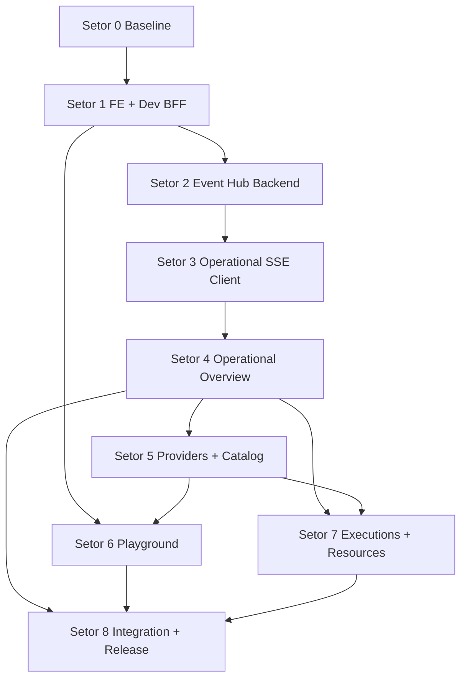

# Frontend MVP — Technical Roadmap

**Status:** Planning artifact (implementation not authorized by this document alone)  
**Date:** 2026-11-03  
**Repository snapshot:** `main` at `09ee001` (`docs: add frontend technical and functional discovery blueprint`)  
**Authoritative inputs:**

- Approved discovery baseline: [`FRONTEND-DISCOVERY.md`](FRONTEND-DISCOVERY.md)
- Inspected backend contracts: [`FRONTEND-MVP.md`](FRONTEND-MVP.md)
- Product context: [`AI-HUB-ROADMAP.md`](../roadmap/AI-HUB-ROADMAP.md)
- Workspace recipe: [`development-workspace.md`](../development-workspace.md)
- ADRs: ADR-011, ADR-019, ADR-020, ADR-021, ADR-022

Each future increment must produce its own approved SPEC (via `/sdd-workflow`) before autonomous implementation begins.

---

## 1. Purpose

This roadmap decomposes the Frontend MVP into **independent, dependency-ordered sectors** so an implementer can execute vertical slices without repeating discovery. It maps discovery increments **FE-01 … FE-07** to concrete engineering work, distinguishes **existing backend capabilities** from **net-new frontend and BFF work**, and records the **critical path** to a releasable single-binary operator UI.

---

## 2. Current State (Evidence at Snapshot)

### 2.1 Delivered (no Frontend MVP work required to “create” these)

| Area | State | Evidence |
| --- | --- | --- |
| Go backend (E01–E07, Phase B, C1/C2, E08.1–E08.5, E09) | Implemented and accepted | `AI-HUB-ROADMAP.md`, AI Memory `status/current-project.md` |
| HTTP contracts for health, diagnostics, catalog, providers, responses, records, resources, analytics | Implemented | Handlers under `cmd/ai-hub/`, `internal/gateway/`; tables in `FRONTEND-MVP.md` |
| Responses streaming (`POST /v1/responses`) | Implemented (OpenAI Responses SSE) | `internal/gateway/responses_handler.go` |
| pnpm + Turborepo workspace globs | Configured | `pnpm-workspace.yaml`, `turbo.json` |
| Frontend discovery & contract inventory | Published | `FRONTEND-DISCOVERY.md`, `FRONTEND-MVP.md` |

### 2.2 Not present (MVP must build)

| Gap | Impact |
| --- | --- |
| `apps/frontend` (and any `packages/*`) | No React app, no Vite config, no JS dependencies installed |
| Same-origin dev proxy / production BFF | Browser cannot call protected routes without server-side credential injection |
| Embedded SPA (`go:embed apps/frontend/dist`) | Production same-origin serving not wired in Go router |
| Browser session / cookie gate for production | Discovery proposes HttpOnly session; **not implemented** in backend today |
| **Operational SSE Event Hub** (`GET /api/events` or `/v1/events`) | **Route does not exist**; zero-polling UI cannot be completed without it |
| Frontend UI (AppShell, pages, hooks, tests) | All net-new |

### 2.3 Partial / directional only

| Item | Notes |
| --- | --- |
| ADR-019 “React + Vite dashboard” | Accepted direction; not an installed stack |
| Discovery decisions D1–D7 | D7 (zero-polling SSE) approved by lead; D1–D3 still marked “requires project lead approval” in discovery matrix — treat as **implementation gates** in Setor 0 |
| Turbo `typecheck` / `check` for JS | Declared in `turbo.json`; **zero tasks run** until first workspace package exists |

---

## 3. MVP Boundaries

### 3.1 In scope (this roadmap)

- Single-operator local/trusted deployment model (discovery D1).
- Alternative A BFF: Vite dev proxy + embedded SPA in Go binary (discovery D2).
- React 19, TypeScript, Vite 6, TanStack Query v5, Tailwind v4, Radix UI, React Router v7 (discovery D3–D4).
- **Zero polling** on the frontend; operational updates via **operational SSE** (discovery D7).
- Playground streaming via **`fetch` + `ReadableStream`** on `POST /v1/responses` (separate from operational SSE).
- Ephemeral in-memory playground history (discovery D5).
- Essential slices FE-01–FE-04; complementary FE-05–FE-07 as later sectors.

### 3.2 Out of scope (MVP)

- Multi-tenant auth, OIDC, RBAC, user accounts.
- Backend-persisted chat / prompt history (violates E06 content-free contract).
- E08.6+ LLM classifier routing, E10 learning engine, full E11 enterprise dashboard.
- CORS enablement or exposing `AIHUB_*_API_KEY` to browser bundles.
- Billing, cost estimation UI (E09.5 metering exists server-side; no billing product in MVP).
- General application settings API (none exists).

### 3.3 Future improvements (post-MVP)

- `sessionStorage` tab-scoped playground recovery (discovery optional enhancement).
- Light theme, shared `packages/ui` design system extraction.
- Durable operational event replay API.
- External identity proxy integration (Cloudflare Access, Authelia).

---

## 4. Recommended Sector Map

Discovery FE increments map to sectors as follows:

| Discovery | Sector(s) | MVP tier |
| --- | --- | --- |
| FE-01 BFF + health + provider overview (SSE) | 0–4 | Essential |
| FE-02 Provider administration | 5 (part 1) | Essential |
| FE-03 Model catalog | 5 (part 2) | Essential |
| FE-04 Playground streaming | 6 | Essential |
| FE-05 Execution records | 7 (part 1) | Complementary |
| FE-06 Resources & analytics | 7 (part 2) | Complementary |
| FE-07 UI preferences | 7 (part 3) or post-MVP polish | Complementary |

**Sector count:** **9** (Setor 0 through Setor 8).

---

## 5. Execution Order, Dependencies, and Critical Path

### 5.1 Recommended order

```text
Setor 0 → Setor 1 → Setor 2 → Setor 3 → Setor 4
                              ↘
Setor 5 (after 4) → Setor 6 (after 1 + 5 partial)
Setor 7 (after 4 + 5)
Setor 8 (after 4–7 as needed for release scope)
```

### 5.2 Dependency graph (high level)



### 5.3 Critical path

**Setor 0 → 1 → 2 → 3 → 4** delivers the first shippable operator experience (FE-01). Without **Setor 2 (backend Event Hub)**, the zero-polling mandate cannot be satisfied for operational screens.

**Setor 6 (Playground)** depends on dev BFF (Setor 1) and catalog/provider selection UX (Setor 5) but **does not** depend on operational SSE (Setor 3).

### 5.4 MVP completion milestones

| Milestone | Sectors complete | Operator-visible outcome |
| --- | --- | --- |
| **M1 — Connected shell** | 0, 1 | Vite app loads; proxy reaches backend; keys not in bundle |
| **M2 — Live operations (FE-01)** | 0–4 | Overview shows real health/providers; updates via operational SSE |
| **M3 — Control plane (FE-02/03)** | 5 | Manage providers and browse/sync catalog |
| **M4 — Execution test (FE-04)** | 6 | Streamed playground against real gateway |
| **M5 — Governance views (FE-05/06)** | 7 | Records + resource/analytics surfaces |
| **M6 — MVP release** | 8 | Embedded SPA + documented operator runbook |

---

## 6. Sector Execution Methodology

Every sector implementation cycle **must** follow:

| Phase | Activities |
| --- | --- |
| **PLANEJAR** | Author or extend SPEC; freeze acceptance criteria; list files, contracts, dependencies; confirm security boundaries. |
| **IMPLEMENTAR** | Smallest vertical slice; reuse backend contracts unchanged; no scope creep into unauthorized epics. |
| **AVALIAR** | Unit/integration tests; `pnpm` typecheck/lint/test for frontend; `go test ./...` for backend changes; manual operator verification; confirm zero key leakage and zero polling timers. |
| **ENTREGAR** | Evidence summary; update AI Memory; open questions; pointer to next sector SPEC. |

This roadmap defines **what** each cycle should contain, not the implementation itself.

---

## 7. Sector Definitions

Legend for deliverable classes:

- **Existing:** already in repository at snapshot; consume only.
- **Improve:** extend current Go/JS tooling minimally.
- **New:** no prior implementation; requires SPEC + tests.

---

### Setor 0 — Baseline and Preparation

#### Objective

Establish a frozen planning baseline so implementation agents start from verified facts and approved boundaries.

#### Scope

- Confirm discovery decisions D1 (single operator), D2 (embedded BFF), D3 (React/Vite), D5 (ephemeral playground), D7 (zero-polling SSE).
- Record snapshot commit, backend test baseline (982 passing / 6 skipped per E09 closure), and PostgreSQL vs file-mode behavior for admin routes.
- Define SPEC naming convention (`docs/specs/FE-0x-*.md`) and traceability to discovery AC IDs.

#### Deliverables

| Class | Item |
| --- | --- |
| Existing | `FRONTEND-DISCOVERY.md`, `FRONTEND-MVP.md`, ADR-011/019 |
| New | Signed decision log entry (lead approval for D1–D3 if not already formalized in `docs/decisions/`) |
| New | Sector 1 SPEC charter referencing FE-01 acceptance criteria |

#### Dependencies

None.

#### Contracts and integrations

Read-only inspection of routes listed in `FRONTEND-MVP.md`; no API changes.

#### Acceptance criteria

- [ ] Written confirmation that operational SSE endpoint is **net-new backend work** (no handler today).
- [ ] Written confirmation that admin and gateway keys stay server-side in all environments.
- [ ] Implementation agent can list “existing vs new” without opening discovery again.

#### Tests

Documentation review; optional `go test ./... -count=1` baseline capture for regression comparison.

#### Risks and observations

- Discovery snapshot commit (`4a2ba70` in discovery header) differs from current `09ee001`; re-verify routes if handlers changed.
- Admin `/api/*` routes absent or degraded when PostgreSQL persistence is disabled — UI must handle 404/503 gracefully.

#### Expected outcome

Authorized starting point for Setor 1 SPEC and implementation.

---

### Setor 1 — Frontend Foundation and Development BFF

Maps to **FE-01 (foundation)** — partial until Setor 3–4 complete.

#### Objective

Create `apps/frontend`, wire Turborepo tasks, and establish the **development-only** same-origin proxy that injects bearer credentials server-side.

#### Scope

| Class | Work |
| --- | --- |
| **New** | Vite + React 19 + TypeScript app under `apps/frontend` |
| **New** | Tailwind CSS v4, Radix primitives, Lucide, React Router shell |
| **New** | TanStack Query provider with `refetchInterval: false` globally |
| **New** | Typed API client + error envelope mapping (`{type, message}`) |
| **New** | Vite `server.proxy` for `/healthz`, `/readyz`, `/diagnostics/providers`, `/v1/*`, `/api/*` with **separate** gateway vs admin key injection from **server env** (never `VITE_*` secrets) |
| **Improve** | Root `package.json` `check` to include `turbo run check` when package exists (per `development-workspace.md`) |
| **Existing** | Backend routes unchanged |

#### Deliverables

- `@connexto/frontend` package scripts: `dev`, `build`, `typecheck`, `lint`, `test`, `check`.
- `AppShell` layout: sidebar nav placeholders, header slots for health/SSE badge (wired in Setor 3).
- API modules: `health`, `readiness`, `providerDiagnostics` (initial **bootstrap fetch on mount** allowed; not polling).
- Vitest + Testing Library + MSW scaffolding.

#### Dependencies

Setor 0.

#### Contracts and integrations

| Method | Path | Auth (via proxy) |
| --- | --- | --- |
| GET | `/healthz` | None |
| GET | `/readyz` | None |
| GET | `/diagnostics/providers` | Gateway key injected by proxy |

#### Acceptance criteria

- [ ] **AC-S1-1:** `pnpm dev` serves UI on `localhost:5173`.
- [ ] **AC-S1-2:** Network tab shows **no** `Authorization` header set by browser JS for protected routes (proxy adds it).
- [ ] **AC-S1-3:** Source maps / bundle scan finds no gateway or admin key literals.
- [ ] **AC-S1-4:** `pnpm --filter @connexto/frontend typecheck` and `test` pass.
- [ ] **AC-S1-5:** Bootstrap load renders backend-down state when Go process stopped.

#### Tests

Vitest for API client error mapping; smoke test for AppShell render.

#### Risks and observations

- Vite proxy must forward `Host`/`Origin` acceptable to backend access policy (ADR-011).
- Do not use `refetchInterval` or `setInterval` for operational refresh — operational updates wait for Setor 3.

#### Expected outcome

Runnable frontend workspace and secure dev transport; overview data visible after initial load.

---

### Setor 2 — Backend Operational Event Hub

**Net-new backend sector** required by discovery D7 and FE-01 AC-FE01-7.

#### Objective

Introduce a long-lived **operational** SSE stream that pushes structured events when system/provider/resource state changes.

#### Scope

| Class | Work |
| --- | --- |
| **New** | SSE route (choose one path in SPEC: e.g. `GET /api/events` for admin-scoped operational feed, or split gateway/admin streams — **must be decided in SPEC**) |
| **New** | Event hub component: subscriber registry, heartbeat/comments, graceful disconnect |
| **New** | Event emission hooks from existing subsystems (minimum viable set): |
| | • readiness / health transition signals |
| | • provider diagnostic changes after probe or enable/disable |
| | • optional: quota/concurrency threshold signals (align with discovery `quota_alert`) |
| **Improve** | Access policy: authenticate stream same as proxied admin or unified BFF session (SPEC) |
| **Existing** | Provider manager, readiness checker, E09 services (emit events, do not duplicate business logic) |

#### Deliverables

- Documented event catalog (JSON payload shapes), e.g. `health_status`, `readiness_changed`, `provider_probe_result`, `provider_toggled`, `quota_alert`.
- Go unit/integration tests for SSE framing, auth rejection, and at least one real emission path.
- ADR addendum or SPEC section if path/auth differs from discovery sketch.

#### Dependencies

Setor 0 (SPEC approval). Can parallelize implementation with Setor 1 after SPEC frozen.

#### Contracts and integrations

| Transport | Endpoint | Notes |
| --- | --- | --- |
| SSE (operational) | `GET /api/events` **or** `GET /v1/events` (**TBD in SPEC**) | Distinct from `POST /v1/responses` inference stream |

#### Acceptance criteria

- [ ] **AC-S2-1:** Authenticated client receives `text/event-stream` with named events.
- [ ] **AC-S2-2:** Unauthenticated or wrong credential receives 401; bad Origin/Host receives 403.
- [ ] **AC-S2-3:** Provider validate/enable/disable causes observable event without frontend polling.
- [ ] **AC-S2-4:** Connection survives idle periods per SPEC (respect `StreamInactivityTimeout` patterns where applicable).

#### Tests

Go handler tests; integration test with fake subscriber; manual curl/`curl -N` evidence.

#### Risks and observations

- Discovery lists candidate paths but **does not implement them** — path and auth namespace are a **formal SPEC decision**.
- Must not conflate operational SSE with Responses token streaming (different clients, different parsers).
- Fiber/SSE flush behavior must match existing gateway streaming lessons (ADR-015, architecture.md).

#### Expected outcome

Backend can push operational state changes to browsers.

---

### Setor 3 — Operational SSE Client (Zero-Polling)

Completes **FE-01 real-time mandate**.

#### Objective

Subscribe to the operational Event Hub and drive TanStack Query cache updates without periodic refetch.

#### Scope

| Class | Work |
| --- | --- |
| **New** | `useOperationalEvents` (discovery name: `useRealtimeEvents`) using `EventSource` |
| **New** | Event → query key router (`setQueryData` / targeted `invalidateQueries`) |
| **New** | Connection badge (“Live SSE”), exponential backoff reconnect, manual reconnect control |
| **Existing** | Query hooks from Setor 1 |

#### Deliverables

- Strict eslint/rule guard: no `refetchInterval`, no operational `setInterval`.
- Vitest tests with mocked EventSource.

#### Dependencies

Setor 1 (frontend), Setor 2 (backend stream).

#### Contracts and integrations

Operational SSE endpoint from Setor 2; event names aligned with backend catalog.

#### Acceptance criteria

- [ ] **AC-S3-1:** Provider status UI updates after backend probe **without** manual refresh or polling timers.
- [ ] **AC-S3-2:** DevTools Performance/Memory shows no periodic GET loop for diagnostics.
- [ ] **AC-S3-3:** Stream drop shows degraded banner; reconnect restores live badge.
- [ ] **AC-S3-4:** Maps to discovery **AC-FE01-7**.

#### Tests

Unit tests for event reducers; manual verification checklist documented in SPEC evidence.

#### Risks and observations

- `EventSource` cannot set custom headers in browsers — **requires** same-origin BFF/proxy or cookie session (Setor 8 for production cookie model).
- Playground must **not** reuse this hook for token deltas.

#### Expected outcome

Operational server state stays fresh with zero polling.

---

### Setor 4 — Operational Overview (Visão Operacional)

Completes **FE-01 UI**.

#### Objective

Deliver the Overview dashboard: system liveness, PostgreSQL readiness, provider diagnostic cards, degraded banners.

#### Scope

| Class | Work |
| --- | --- |
| **New** | `OverviewPage`, status cards, provider grid, empty/degraded/error states |
| **New** | Manual “Reconnect SSE” / “Refresh snapshot” actions (explicit user intent only) |
| **Existing** | Data from `/healthz`, `/readyz`, `/diagnostics/providers` + SSE updates |

#### Deliverables

- Navigation entry “Overview” as default route.
- Status palette per discovery §8.2 (healthy/degraded/unhealthy tokens).

#### Dependencies

Setor 1, 3 (recommended); Setor 2.

#### Contracts and integrations

Same as Setor 1 plus operational SSE events for provider/readiness changes.

#### Acceptance criteria

- [ ] **AC-S4-1:** Matches discovery **AC-FE01-3..6** (healthy DB, real provider cards, backend stopped UX).
- [ ] **AC-S4-2:** Unhealthy provider shows error cause from diagnostics payload.
- [ ] **AC-S4-3:** File-mode / admin-unavailable surfaces informative empty state, not uncaught exceptions.

#### Tests

Component tests for badge states; optional Playwright smoke (Setor 8).

#### Risks and observations

- Diagnostics require gateway key — proxy must be stable before UI polish.
- High information density — avoid mock data in production paths.

#### Expected outcome

**M2 milestone:** FE-01 complete in development environment.

---

### Setor 5 — Provider Administration and Model Catalog

Maps to **FE-02** and **FE-03**.

#### Objective

Enable operator control of providers and exploration/sync of normalized catalog.

#### Scope

| Class | Work |
| --- | --- |
| **New** | Providers list/detail pages, enable/disable, validate probe, credential PATCH forms (write-only) |
| **New** | Catalog table with filters (`provider`, `capability`, `presence`, `listing_state`), detail drawer, sync action |
| **New** | Optimistic UI + SSE reconciliation for provider toggles |
| **Existing** | Admin API routes (`/api/providers/*`), catalog routes (`/v1/catalog/*`) |

#### Deliverables

- React Hook Form + Zod for provider forms.
- Admin proxy routes validated end-to-end.

#### Dependencies

Setor 4 (shell + SSE); Setor 1 BFF admin proxy.

#### Contracts and integrations

| Area | Endpoints |
| --- | --- |
| Providers | `GET/POST/PATCH /api/providers`, `POST .../validate`, `.../enable`, `.../disable` |
| Catalog | `GET /v1/catalog/models`, `GET .../{provider}/{model...}`, `GET /v1/catalog/providers`, `POST /v1/catalog/sync` |

#### Acceptance criteria

- [ ] **AC-S5-1:** Credential fields never repopulate from API; only “configured” boolean shown.
- [ ] **AC-S5-2:** Validate triggers probe spinner and SSE-updated status card.
- [ ] **AC-S5-3:** Catalog sync shows in-progress/disabled/conflict states (409) per contract.
- [ ] **AC-S5-4:** Capability provenance and `execution_verification` visible where catalog returns them.

#### Tests

MSW contract tests for admin errors; form validation unit tests.

#### Risks and observations

- PostgreSQL mode required for provider admin — detect via `/readyz` database check.
- Catalog sync is privileged; guard against double-submit while 409 in progress.

#### Expected outcome

**M3 milestone:** Operators manage providers and inspect catalog without CLI.

---

### Setor 6 — Playground with Inference Streaming

Maps to **FE-04**.

#### Objective

Interactive prompt testing with **inference SSE** via `fetch` streaming, independent from operational Event Hub.

#### Scope

| Class | Work |
| --- | --- |
| **New** | `usePlayground` reducer (discovery §4.3.2), provider/model pickers, streaming markdown/text view |
| **New** | SSE parser for OpenAI Responses events on response body (incremental chunks, terminal events) |
| **New** | `AbortController` stop button; structured error banners (429, 502, 503, routing errors) |
| **Existing** | `POST /v1/responses`, optional `X-AIHub-Provider`, E08 routing behavior |

#### Deliverables

- In-memory message list only (no backend persistence).
- Execution summary drawer (TTFT, duration, model id from stream metadata when present).

#### Dependencies

Setor 1 (gateway proxy); Setor 5 (model/provider selection UX strongly recommended).

#### Contracts and integrations

| Method | Path | Client |
| --- | --- | --- |
| POST | `/v1/responses` | `fetch` + `ReadableStream` reader (not `EventSource`) |

#### Acceptance criteria

- [ ] **AC-S6-1:** Streaming tokens render progressively; cancel aborts request cleanly.
- [ ] **AC-S6-2:** Page refresh clears conversation (ephemeral contract).
- [ ] **AC-S6-3:** Quota/concurrency rejection surfaces normalized error category.
- [ ] **AC-S6-4:** No operational polling introduced for playground state.

#### Tests

Parser unit tests with chunked fixtures from gateway tests; MSW streaming mock.

#### Risks and observations

- **R2:** 2-minute stream inactivity timeout — UI must handle mid-stream disconnect.
- Do not store prompts in localStorage unless FE-07 explicitly expands scope.
- Routing ambiguity errors (E08) must display explainable messages when backend provides them.

#### Expected outcome

**M4 milestone:** Developers test models through the Hub UI.

---

### Setor 7 — Executions and Resources

Maps to **FE-05**, **FE-06**, and optional **FE-07**.

#### Objective

Expose content-free execution audit trail and E09 governance/analytics surfaces.

#### Scope

| Class | Work |
| --- | --- |
| **New** | Executions table + detail drawer (`GET /v1/records/executions*`) |
| **New** | Resource/concurrency policy editors and usage KPIs |
| **New** | Analytics charts for admissions, quota utilization, provider usage series |
| **New (optional FE-07)** | `UiContext` preferences (sidebar, theme) in client state only |
| **Existing** | E06 records API; E09 admin + analytics routes |

#### Deliverables

- Cursor pagination UI for executions.
- Policy forms mirroring PUT contracts; enable/disable endpoints.
- Read-only analytics date-range picker (RFC3339 / YYYY-MM-DD, max 366 days).

#### Dependencies

Setor 4–5 (navigation, SSE for usage/quota alerts if emitted in Setor 2).

#### Contracts and integrations

Records: `/v1/records/executions*`.  
Resources: `/api/resource-policies*`, `/api/concurrency-*`, `/api/resource-usage`, `/api/concurrency-usage`.  
Analytics: `/api/resource-analytics/*` (see `FRONTEND-MVP.md`).

#### Acceptance criteria

- [ ] **AC-S7-1:** Execution detail never displays prompt/response bodies (metadata only).
- [ ] **AC-S7-2:** Analytics null token metrics render as “unknown”, explicit zero as zero.
- [ ] **AC-S7-3:** Policy edits reflect in usage views after SSE or explicit snapshot refresh.
- [ ] **AC-S7-4:** `Cache-Control: no-store` respected (no stale admin caching assumptions).

#### Tests

Table pagination tests; chart data adapter unit tests.

#### Risks and observations

- E06 `usage` field remains null on records; do not conflate with E09.5 metering analytics.
- Heavy charts — keep complementary tier acceptable for MVP release scope trade-offs.

#### Expected outcome

**M5 milestone:** Governance visibility without psql/CLI.

---

### Setor 8 — Integration Testing and MVP Release

#### Objective

Close the development–production gap: embedded SPA, production session boundary, automated gates, operator runbook.

#### Scope

| Class | Work |
| --- | --- |
| **New** | `go:embed` static assets from `apps/frontend/dist`; Fiber/static routes for `/`, `/assets/*` |
| **New** | Production BFF session (HttpOnly cookie or loopback-only bypass per discovery §5–6) — **SPEC required** |
| **New** | CI/local script: build frontend → embed → `go test` + smoke |
| **Improve** | Root `pnpm check` runs Go + turbo frontend checks |
| **New** | E2E smoke (Playwright or scripted): overview SSE, one provider validate, one playground stream |
| **Existing** | Release versioning, README operator section update (**only when authorized**) |

#### Deliverables

- Documented operator startup: single binary on `:8080`, env vars, PostgreSQL URL.
- Evidence bundle: test outputs, manual checklist, AI Memory session page.

#### Dependencies

Essential sectors 0–6 complete; sector 7 per release scope agreement.

#### Contracts and integrations

All prior routes via same-origin production server; operational SSE and playground streaming both verified on embedded origin.

#### Acceptance criteria

- [ ] **AC-S8-1:** Production build serves SPA from Go binary without separate Node process.
- [ ] **AC-S8-2:** Browser bundle still contains no static API keys after embed.
- [ ] **AC-S8-3:** Full `go test ./... -count=1 -race` and frontend `check` pass in release pipeline.
- [ ] **AC-S8-4:** MVP milestone checklist M1–M6 signed off.

#### Tests

Go embed handler tests; E2E smoke; manual security review of cookie/session flags.

#### Risks and observations

- Session design is underspecified vs bearer injection in dev — **largest production gap**.
- SPA client-side routing may require fallback to `index.html` for deep links (SPEC must define).
- Embedding increases binary size — acceptable for MVP.

#### Expected outcome

**M6 milestone:** Releasable Frontend MVP aligned with local-first single-binary philosophy.

---

## 8. Cross-Cutting Concerns

### 8.1 Two SSE channels (mandatory separation)

| Channel | Purpose | Client API | Endpoint |
| --- | --- | --- | --- |
| **Operational** | Health, providers, quotas, admin notifications | `EventSource` (+ BFF auth) | New Event Hub (Setor 2) |
| **Inference** | Playground token streaming | `fetch` + stream reader | `POST /v1/responses` (existing) |

### 8.2 Security checklist (all sectors)

- Gateway and admin keys only in Go process or Vite **server** config.
- Provider credentials write-only via PATCH; never render API-returned secrets.
- No CORS shortcuts.
- Host/Origin policy preserved (ADR-011).

### 8.3 Persistence mode awareness

When PostgreSQL checks fail or admin routes unavailable, UI shows degraded mode — not silent failure.

---

## 9. Open Decisions and Gaps (Require SPEC or Lead Input)

| ID | Topic | Status | Recommended owner sector |
| --- | --- | --- | --- |
| G1 | Formal lead sign-off for D1–D3 on record | Discovery matrix says “requires approval” | Setor 0 |
| G2 | Operational SSE path and auth namespace (`/api/events` vs `/v1/events`) | Not implemented | Setor 2 SPEC |
| G3 | Production session cookie vs loopback-only MVP | Described in discovery, not coded | Setor 8 SPEC |
| G4 | Event payload JSON schema versioning | Not defined | Setor 2 SPEC |
| G5 | Which E09 signals emit SSE in MVP (`quota_alert` minimum set) | Partially described | Setor 2 SPEC |
| G6 | FE-07 UI preferences in MVP vs post-MVP | Complementary | Setor 7 scope negotiation |
| G7 | E2E tool choice (Playwright vs script) | Open | Setor 8 |

---

## 10. Traceability Matrix (Discovery AC → Sectors)

| Discovery AC | Sector |
| --- | --- |
| AC-FE01-1 App boot | 1 |
| AC-FE01-2 Zero key leakage | 1, 8 |
| AC-FE01-3 Real health display | 1, 4 |
| AC-FE01-4 Provider diagnostics | 1, 4 |
| AC-FE01-5 Backend stopped UX | 1, 4 |
| AC-FE01-6 Degraded provider | 4 |
| AC-FE01-7 Zero polling / operational SSE | 2, 3 |

---

## 11. References

- [`FRONTEND-DISCOVERY.md`](FRONTEND-DISCOVERY.md) — product, UX, FE-01 proposal, decision matrix
- [`FRONTEND-MVP.md`](FRONTEND-MVP.md) — route inventory and security notes
- [`../roadmap/AI-HUB-ROADMAP.md`](../roadmap/AI-HUB-ROADMAP.md) — backend delivery status
- [`../development-workspace.md`](../development-workspace.md) — scaffold commands and turbo integration
- [`../adr/ADR-011-gateway-authentication-and-network-exposure.md`](../adr/ADR-011-gateway-authentication-and-network-exposure.md)
- [`../adr/ADR-019-hybrid-monorepo-workspace-tooling.md`](../adr/ADR-019-hybrid-monorepo-workspace-tooling.md)

---

## 12. Document Control

| Field | Value |
| --- | --- |
| Created | 2026-11-03 |
| Implements code | No |
| Modifies existing files | No (this file only) |
| Next action | Setor 0 lead confirmations → SPEC FE-01 → Setor 1 implementation |
