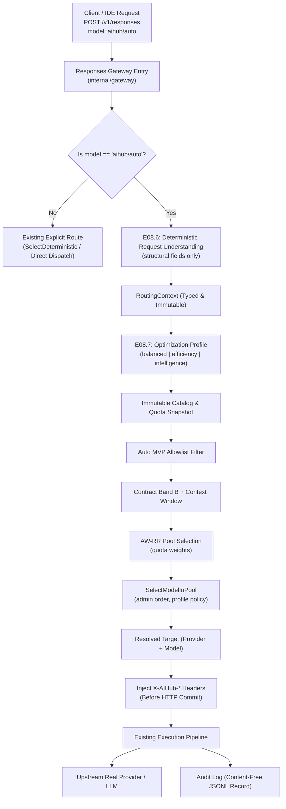

# Auto AI-Hub Specification (AUTO-SPEC)

**Document Version:** 1.1.0  
**Status:** Approved (Amendment 2026-11-12 — E08 close-out)  
**Date:** 2026-11-09 (Amended 2026-11-12)  
**Owners:** Connexto AI-Hub Core Team  
**Scope:** Virtual Model `aihub/auto`, E08.6 Request Understanding, E08.7 Optimization Profiles, E08.8 Ranked Intelligent Selector, Pre-Commit Transparency Headers, Strict Fallback & Governance.

---

## 1. Executive Summary & Product Objective

The **Auto AI-Hub** transforms the AI-Hub into an intelligent gateway featuring a universal virtual model identifier: `aihub/auto`. Any OpenAI-compatible client (Cursor, OpenCode, CLI, external SDKs) can select `aihub/auto` exactly like any concrete model.

The central product principle is:
> **The user selects Auto. AI-Hub selects the executor.**

Auto AI-Hub builds directly upon the validated deterministic foundation of **E08 Intelligent Routing** (`EvaluateEligibility`, `SelectDeterministic`, immutable catalog snapshots, and the Responses Gateway pipeline). It does not duplicate providers or pipelines; rather, it introduces:
- **E08.6: Request Understanding** (deterministic feature extraction in v1).
- **E08.7: Optimization Profiles** (`balanced`, `efficiency`, `intelligence`).
- **E08.8: Pool-Based Intelligent Selector** (allowlist, contract bands, AW-RR pool pick, in-pool profile policy — **not** multi-dimensional scoring in v1).
- **Pre-Commit HTTP Transparency Headers**: Returning exact routing metadata prior to HTTP streaming body commitment.
- **Governance (evidence-only)**: Gate 0 homologation is tracked in `auto_evidence.go` and reports under `reports/`; it does **not** block `aihub/auto` at runtime. The allowlist was reduced to **seven** models on 2026-11-12 (see `docs/decisions/e08-auto-gate0-allowlist-reduction-2026-11-12.md`).

---

## 2. Public API & Routing Contract

### 2.1 Model Identification
- **Model ID:** `aihub/auto`
- **Model Type:** `virtual`
- **Owner:** `connexto`
- **Dynamic Resolution:** `aihub/auto` is intercepted at the gateway level. It is **never** registered as a concrete upstream provider or given mock credentials.
- **Anti-Recursion Invariant:** The virtual ID `aihub/auto` is strictly excluded from candidate target evaluation. It can never route to itself.

### 2.2 Response Body Contract
In compliance with OpenAI Responses API specifications:
- The top-level response field `"model"` in the returned JSON (or terminal streaming chunk) MUST contain the identifier of the **actually executed concrete model** (e.g., `"model": "gpt-6-luna"` or `"model": "anthropic/claude-haiku-4.5"`).
- Internal audit logs preserve `requested_model = "aihub/auto"`.

### 2.3 HTTP Transparency Headers
All responses dispatched via `aihub/auto` MUST inject four standardized HTTP headers **strictly before the HTTP response header commit** (prior to transmitting any chunk or body byte to the client):

| Header Name | Type / Values | Description |
| :--- | :--- | :--- |
| `X-AIHub-Resolved-Model` | String (e.g. `gpt-6-luna`) | Concrete model selected and dispatched. |
| `X-AIHub-Resolved-Provider` | String (e.g. `opencode`, `openrouter`) | Concrete provider selected. |
| `X-AIHub-Routing-Profile` | String (`balanced`, `efficiency`, `intelligence`) | Optimization profile applied. |
| `X-AIHub-Routing-Reason` | Controlled String Code | Most specific public reason from the in-pool decision (see §5.3). |

**Accepted reason codes (v1.1):** `awrr_pool_select`, `reasoning_preferred`, `reasoning_preference_unmatched`, `efficiency_fast_path`.

**Privacy & Content-Free Rule:** `X-AIHub-Routing-Reason` MUST strictly use controlled alphanumeric reason tokens. It MUST NEVER contain prompts, user text, or unvetted stack traces.

---

## 3. Architecture & Request Pipeline

Implementation reference: `apps/backend/internal/routing/auto_selector.go`, `auto_balance.go`, `auto_shape.go`, `auto_evidence.go`.

---

## 4. E08.6: Deterministic Request Understanding

### 4.1 Specification
Request Understanding is the first stage of Auto resolution. For v1, it is **100% deterministic and structural**. No remote LLM call is made to classify requests. **Prompt text is not read** for routing.

From the incoming request payload (`POST /v1/responses`), the parser extracts bounded structural metadata, including:
1. Tool / structured-output / modality requirements (via existing eligibility projection).
2. `IsStreaming`: boolean from `stream: true`.
3. `EstimatedInputTokens`: heuristic from payload size.
4. `ReasoningEffort`, `InputItemCount`, and related structural fields where present.
5. `OptimizationProfile`: `balanced`, `efficiency`, or `intelligence`.

### 4.2 Explicit cuts (Amendment 2026-11-12)
The following **are not part of the accepted contract**:
- **`ExplicitConstraints`** (user/admin include or exclude provider lists) — no client sends them; not implemented on the auto path.
- **Text or LLM-based classifiers** — out of scope; content-blind routing is preserved.

---

## 5. E08.7: Optimization Profiles

All three profiles are active in v1.1. Quota pool selection (AW-RR) is unchanged across profiles; profile policy applies only inside `SelectModelInPool`.

| Profile | In-pool behavior |
| :--- | :--- |
| **`balanced`** (default) | Administrative tie order within contract band. On **heavy request shape** (high/`xhigh` reasoning effort, ≥30k estimated input tokens, or ≥8 input items), prefer the first admin-ordered model with catalog `reasoning` supported; otherwise admin order with `reasoning_preference_unmatched`. |
| **`efficiency`** | Administrative tie order; on short non-streaming calls, deprioritize models with known runtime overhead (Antigravity `gemini-3.8-flash` today). **Does not** apply reasoning preference even when the request shape is heavy. |
| **`intelligence`** | Treat every request as heavy shape: always attempt reasoning preference in admin order; fall back to admin order with `reasoning_preference_unmatched`. |

`medium` reasoning effort does **not** alone trigger heavy shape (balanced stays on admin order).

### 5.1 Heavy request shape
Defined in `auto_shape.go` (`isHeavyRequestShape`), with `intelligence` profile always heavy.

### 5.2 Public routing reason
`X-AIHub-Routing-Reason` MUST be the **most specific** code produced by in-pool selection, in this precedence order when multiple internal reason tokens exist:
1. `reasoning_preferred`
2. `reasoning_preference_unmatched`
3. `efficiency_fast_path`
4. `awrr_pool_select` (default when no more specific in-pool code applies)

---

## 6. E08.8: Pool-Based Intelligent Selector

### 6.1 Pipeline stages (accepted implementation)
1. **Allowlist:** Intersect eligibility with `AutoMVPAllowlist` (seven models as of 2026-11-12).
2. **Contract band B + evidence:** `FilterAutoBandBCandidates` / per-model proofs in `auto_evidence.go`.
3. **Context window:** Drop candidates below `EstimatedInputTokens` when catalog context is known.
4. **Pool selection:** Smooth weighted round-robin (`SelectPoolAWRR`) using quota snapshot weights.
5. **In-pool model:** `SelectModelInPool` — admin tie order + profile policy (§5).

### 6.2 Explicit cuts (Amendment 2026-11-12) — superseded text
The following v1.0 specification elements are **withdrawn** and MUST NOT be implemented without a new approved amendment:

| Withdrawn element | Rationale | Accepted substitute |
| :--- | :--- | :--- |
| **§6.2 multi-dimensional score** `fit + latency + quota` | No verifiable latency/cost time series; execution records still carry `usage: null` in practice. | AW-RR pool weights + structural reasoning preference in `auto_shape.go`. |
| **§7 pre-commit retry on 2nd-ranked candidate** (503/timeout) | E08 AC-8 and gateway tests forbid a second provider invocation after selection failure. | Single upstream attempt; 429/503/timeout are forwarded without model swap. |
| **ExplicitConstraints & text classifier** | No clients; prompt reading forbidden. | Structural understanding only (§4). |

### 6.3 Tie-Breaking Policy
Within a pool, **administrative priority** (`AutoAdminTieOrder`) is authoritative. Lexicographic or random tie-breaking is forbidden.

---

## 7. Failure, Quota & Fallback Matrix

| Scenario | Engine Reaction | Fallback Permitted? |
| :--- | :--- | :--- |
| **Quota exhausted in snapshot** | Candidate excluded in Eligibility Engine (E08.2). | N/A (Not a fallback; normal selection). |
| **Upstream returns HTTP 429 (Quota Exceeded)** | Forward HTTP 429 directly to client with reset headers. | **NO**. Never retry on 429 automatically in v1. |
| **Upstream returns HTTP 503 / Network Timeout** | Log transient failure. Forward error to client. | **NO** pre-commit model swap (Amendment 2026-11-12). |
| **Failure AFTER HTTP commit (streaming in progress)** | Terminate stream with connection error/SSE error frame. | **STRICTLY FORBIDDEN**. Never switch models mid-stream. |

---

## 8. Gate 0 & Homologation

- `auto_evidence.go` holds per-model smoke/schema flags and `Gate0Approved`.
- `AutoGate0Satisfied()` and `Gate0Approved` flags are for operators and audits only; they do not gate routing.
- Gate 0 approval MUST follow a documented homologation report under `reports/` (no flag flip without evidence).

---

## 9. Evidence Block (Mandatory SDD Specification)

- **Claim:** The `E08.6 Request Understanding` module correctly extracts structural requirements into an immutable `RoutingContext` with zero network calls and deterministic guarantees.
- **Success Type:** Automated Unit & Integration Tests (`go test ./internal/routing/... -count=1`, gateway header integration test).
- **Evidence Path:** `internal/routing/*_test.go`, `internal/gateway/responses_routing_integration_test.go`.
- **Affordance:** Full compatibility with existing `internal/routing/types.go` and `internal/gateway` handlers.

---

## 10. Amendment log

| Version | Date | Summary |
| :--- | :--- | :--- |
| 1.0.0 | 2026-11-09 | Initial approved AUTO-SPEC (vision scoring, balanced-only profile). |
| 1.1.0 | 2026-11-12 | E08 close-out: accept implemented AW-RR + in-pool profiles; cut scoring, pre-commit retry, ExplicitConstraints/classifier; document Gate 0 and public routing reason codes. |
