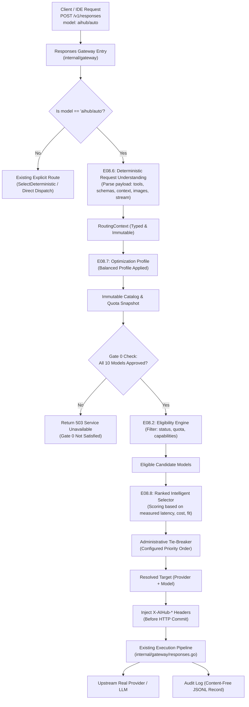

# Auto AI-Hub Specification (AUTO-SPEC)

**Document Version:** 1.0.0  
**Status:** Approved  
**Date:** 2026-11-09  
**Owners:** Connexto AI-Hub Core Team  
**Scope:** Virtual Model `aihub/auto`, E08.6 Request Understanding, E08.7 Optimization Profiles, E08.8 Ranked Intelligent Selector, Pre-Commit Transparency Headers, Strict Fallback & Governance.

---

## 1. Executive Summary & Product Objective

The **Auto AI-Hub** transforms the AI-Hub into an intelligent gateway featuring a universal virtual model identifier: `aihub/auto`. Any OpenAI-compatible client (Cursor, OpenCode, CLI, external SDKs) can select `aihub/auto` exactly like any concrete model.

The central product principle is:
> **The user selects Auto. AI-Hub selects the executor.**

Auto AI-Hub builds directly upon the validated deterministic foundation of **E08 Intelligent Routing** (`EvaluateEligibility`, `SelectDeterministic`, immutable catalog snapshots, and the Responses Gateway pipeline). It does not duplicate providers or pipelines; rather, it introduces:
- **E08.6: Request Understanding** (deterministic feature extraction in v1).
- **E08.7: Optimization Profiles** (starting with `Balanced` in v1).
- **E08.8: Ranked Intelligent Selector** (rigid eligibility filters + multi-dimensional scoring + administrative tie-breaking).
- **Pre-Commit HTTP Transparency Headers**: Returning exact routing metadata prior to HTTP streaming body commitment.
- **Strict Governance**: Gate 0 requires all 10 catalog models to be formally approved before production Auto routing is unlocked.

---

## 2. Public API & Routing Contract

### 2.1 Model Identification
- **Model ID:** `aihub/auto`
- **Model Type:** `virtual`
- **Owner:** `connexto`
- **Dynamic Resolution:** `aihub/auto` is intercepted at the gateway level. It is **never** registered as a concrete upstream provider or given mock credentials.
- **Anti-Recursion Invariant:** The virtual ID `aihub/auto` is strictly excluded from candidate target evaluation. It can never route to itself.

### 2.2 Response Body Contract
In compliance with OpenAI Responses API specifications:
- The top-level response field `"model"` in the returned JSON (or terminal streaming chunk) MUST contain the identifier of the **actually executed concrete model** (e.g., `"model": "gpt-6-luna"` or `"model": "anthropic/claude-haiku-4.5"`).
- Internal audit logs preserve `requested_model = "aihub/auto"`.

### 2.3 HTTP Transparency Headers
All responses dispatched via `aihub/auto` MUST inject four standardized HTTP headers **strictly before the HTTP response header commit** (prior to transmitting any chunk or body byte to the client):

| Header Name | Type / Values | Description |
| :--- | :--- | :--- |
| `X-AIHub-Resolved-Model` | String (e.g. `gpt-6-luna`) | Concrete model selected and dispatched. |
| `X-AIHub-Resolved-Provider` | String (e.g. `opencode`, `openrouter`) | Concrete provider selected. |
| `X-AIHub-Routing-Profile` | String (`balanced`, `efficiency`, `intelligence`) | Optimization profile applied. |
| `X-AIHub-Routing-Reason` | Controlled String Code (e.g. `best_task_fit`, `lowest_latency`, `capability_match`) | High-level deterministic reason code. |

**Privacy & Content-Free Rule:** `X-AIHub-Routing-Reason` MUST strictly use controlled alphanumeric reason tokens. It MUST NEVER contain prompts, user text, or unvetted stack traces.

---

## 3. Architecture & Request Pipeline



---

## 4. E08.6: Deterministic Request Understanding

### 4.1 Specification
Request Understanding is the first stage of Auto resolution. For v1, it is **100% deterministic and structural**. No remote LLM call is made to classify requests.

From the incoming request payload (`POST /v1/responses`), the parser extracts:
1. `RequiresToolCalling`: boolean, `true` if `tools` array is present and non-empty.
2. `RequiresJSONSchema`: boolean, `true` if `response_format` specifies `json_schema` or `type: "json_object"`.
3. `RequiresImageInput`: boolean, `true` if any message part contains image URLs or base64 multimodal data.
4. `IsStreaming`: boolean, `true` if `stream: true`.
5. `EstimatedInputTokens`: integer estimate based on character/byte length heuristic (4 characters ≈ 1 token) or structured payload size.
6. `ExplicitConstraints`: optional slice of excluded/included provider IDs configured by user/admin.

### 4.2 Data Structures (`internal/routing`)
```go
package routing

type RequestRequirements struct {
	RequiresToolCalling bool
	RequiresJSONSchema  bool
	RequiresImageInput  bool
	IsStreaming         bool
	EstimatedInputTokens int
}

type RoutingContext struct {
	RequestID           string
	OriginalModel       string
	Requirements        RequestRequirements
	OptimizationProfile OptimizationProfile
	Timestamp           time.Time
}
```

---

## 5. E08.7: Optimization Profiles

In v1, only the `Balanced` profile is active for routing decisions:
- **`balanced` (Default):** Selects candidates that satisfy all functional capabilities, balancing lowest observed latency and quota efficiency.
- **`efficiency`:** Reserved in specification; prioritizes minimal quota and rapid turnaround.
- **`intelligence`:** Reserved in specification; prioritizes top benchmark reasoning for large-context or multi-step tasks.

---

## 6. E08.8: Ranked Intelligent Selector & Tie-Breaking

### 6.1 Eligibility Stage (Hard Filters)
A candidate model $M$ from provider $P$ is eligible if and only if:
1. $P$ and $M$ are enabled in the current catalog snapshot.
2. $M$ has formal homologation approval (`Status == "homologated"`).
3. If `RequiresToolCalling == true`, $M$ has verified tool calling support.
4. If `RequiresJSONSchema == true`, $M$ has verified JSON schema support.
5. If `RequiresImageInput == true`, $M$ has verified multimodal image support.
6. Quota for $P/M$ is NOT exhausted in the current snapshot (known exhausted quotas are pruned here).
7. Context window limit of $M \ge EstimatedInputTokens$.

### 6.2 Scoring & Ranking
Eligible candidates are scored deterministically based on verified metrics:
$$\text{Score}(M) = w_{\text{fit}} \cdot S_{\text{fit}} + w_{\text{lat}} \cdot S_{\text{lat}} + w_{\text{quota}} \cdot S_{\text{quota}}$$
Where:
- $S_{\text{fit}}$: Task and capability alignment.
- $S_{\text{lat}}$: Inverse historical latency (favoring faster TTFT).
- $S_{\text{quota}}$: Health and cost efficiency of available allowance.

### 6.3 Tie-Breaking Policy
If two or more candidates produce identical scores:
- Selection follows an **explicit administrative priority list** defined in configuration (e.g. `[opencode/gpt-6-luna, openrouter/anthropic/claude-haiku-4.5, ...]`).
- If no priority rule breaks the tie, an explainable deterministic decision error is logged, and the first registered candidate in the snapshot order is chosen. Lexicographic or random tie-breaking is forbidden.

---

## 7. Failure, Quota & Fallback Matrix

| Scenario | Engine Reaction | Fallback Permitted? |
| :--- | :--- | :--- |
| **Quota exhausted in snapshot** | Candidate excluded in Eligibility Engine (E08.2). | N/A (Not a fallback; normal selection). |
| **Upstream returns HTTP 429 (Quota Exceeded)** | Forward HTTP 429 directly to client with reset headers. | **NO**. Never retry on 429 automatically in v1. |
| **Upstream returns HTTP 503 / Network Timeout BEFORE HTTP commit** | Log transient failure. Retry exactly once on 2nd-ranked eligible candidate. | **YES** (Single pre-commit retry authorized). |
| **Failure AFTER HTTP commit (streaming in progress)** | Terminate stream with connection error/SSE error frame. | **STRICTLY FORBIDDEN**. Never switch models mid-stream. |

---

## 8. Evidence Block (Mandatory SDD Specification)

- **Claim:** The `E08.6 Request Understanding` module correctly extracts structural requirements (`tools`, `json_schema`, `images`, `stream`, context tokens) into an immutable `RoutingContext` with zero network calls and deterministic guarantees.
- **Success Type:** Automated Unit & Property-Based Tests (`go test ./internal/routing/... -count=1`).
- **Evidence Path:** `internal/routing/parser_test.go` executing all requirement combinations and boundary conditions.
- **Budget:** < 1ms execution time per request parse; 0 external allocations for common cases.
- **Affordance:** Full compatibility with existing `internal/routing/types.go` and `internal/gateway` handlers.

