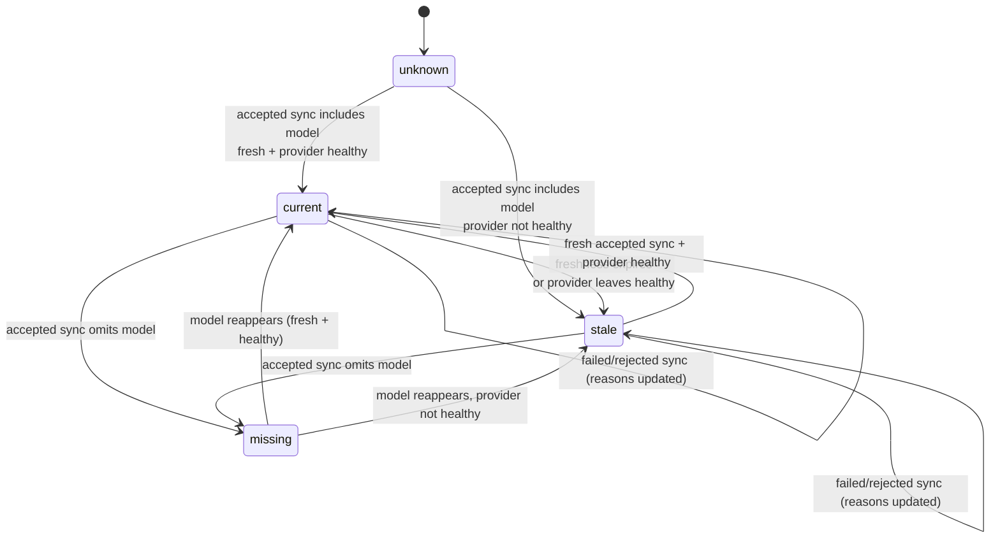

# SPEC E03 — Model Catalog

Status: approved — revision 4 plus approved amendment A1 (2026-10-30),
revision 5.
Workflow: SDD. Evidence base: `docs/research/opencode-go-protocol-spike.md`,
`docs/validation/E02-codex-opencode-go-e2e.md`, live catalog sample (28 models,
2026-10-30), and the upstream documentation consulted for modality semantics
(see §5.3). Design: `docs/design/E03-model-catalog-design.md`. Decisions:
ADR-009 (identity, capability claims, listing semantics) and ADR-010 (snapshot
persistence).

Revision 3 incorporated four targeted refinements: conservative modality
inference (Q1), explicit `listing_state` semantics (Q3), snapshot preservation
tests (Q5), and precise `missing` counter semantics. Revision 4 clarified the
Q5 snapshot invariants: previous-valid-snapshot preservation is distinguished
from corrupt-snapshot quarantine preservation, atomic visibility is
distinguished from crash durability, and the `close` failure path is explicit.
Revision 5 records approved amendment A1: `persistence` joins
`SyncErrorClass`, and a snapshot write failure updates only operational attempt
metadata while leaving accepted catalog state untouched. No other behavior
changed.

## 1. Objective

Give AI Hub a persistent, inspectable, provider-agnostic catalog of the models
its providers expose: provider-scoped identity, evidence-based capability
claims with provenance and confidence, and a synchronization lifecycle that
never destroys known data because a provider failed or returned a suspicious
payload. E03 records facts; it does not choose, rank or route.

## 2. Scope

| In scope | Out of scope |
| --- | --- |
| `internal/catalog`: domain, snapshot store, sync manager, queries | Routing, eligibility, ranking, scoring, learning |
| Capability normalization + provenance/confidence for OpenCode Go | Capability probes or empirical execution verification |
| Versioned JSON snapshot with quarantine recovery | User model enablement / policy (E09) |
| Startup (async) + manual (`POST`) synchronization | Periodic refresh / scheduler |
| Read APIs under `/v1/catalog` | Manual model registration |
| Presence, freshness, provider state and verification as separate dimensions | Cross-provider canonical merging |
| Fake-upstream, store-recovery and counter tests; opt-in live sync smoke | Cost/quota modeling (E09); dashboard (E11) |
| | Harness-facing API changes; `/v1/models` stays the E02 passthrough |

## 3. Packages and contracts

```text
internal/catalog        new: ModelEntry, CapabilityClaim, ProviderSyncState,
                             CatalogView, snapshot store, sync manager, queries
internal/providers      + ModelDescriptor and FetchModelDescriptors
                          (parsing only; ListModels/passthrough unchanged)
internal/gateway        + GET /v1/catalog/models
                          GET /v1/catalog/models/{provider}/{model...}
                          GET /v1/catalog/providers
                          POST /v1/catalog/sync
internal/config         + data_dir, catalog.stale_after, catalog.sync_timeout
internal/server         unchanged (Route injection already exists)
cmd/ai-hub              order: providers -> catalog -> http-server
docs/                   SPEC, architecture, README, ADR-009
```

No provider abstraction interface and no new dependency are introduced. The
provider package parses its own JSON; `catalog` maps the concrete
`providers.ModelDescriptor` into normalized entries. A neutral descriptor
contract is extracted only when a second provider exists (same stance as E02
§3).

## 4. Domain model

### 4.1 `ModelEntry` (persisted)

Identity: `(provider_id, model_id)`. `canonical_id` is vendor metadata and may
be absent; it is never a key and never merges models across providers.

| Field | Type | Source |
| --- | --- | --- |
| `provider_id` | string | AI Hub |
| `model_id` | string | upstream `id`, preserved verbatim |
| `canonical_id` | string? | upstream `canonical_id` |
| `name` | string | upstream `name` |
| `type` | string? | upstream `type` |
| `family` | string? | upstream `family` |
| `modalities` | `{input []string, output []string}`, nil when absent | upstream `modalities` |
| `limits` | `{context?, input?, output? *int64}` | upstream `limit.*` |
| `capabilities` | `map[string]CapabilityClaim` | derived per §5 |
| `provider_metadata` | `json.RawMessage` | full upstream object |
| `first_seen_at` | timestamp (UTC) | AI Hub |
| `last_seen_at` | timestamp (UTC) | AI Hub, accepted syncs only |
| `missing_since` | timestamp? | AI Hub, first accepted sync omitting it |

Not normalized in E03 (preserved only in `provider_metadata`): `cost`, `api`,
`description`, `open_weights`, `owned_by`, `created`, `release_date`,
`last_updated`, `knowledge`, reasoning effort levels, tool-choice modes,
`temperature`/`top_p`/`top_k`/`system_updates`/`effort_updates`/`cache`,
video/PDF modalities. Cost modeling belongs to E09.

### 4.2 `CapabilityClaim`

| Field | Values in E03 | Meaning |
| --- | --- | --- |
| `state` | `supported \| unsupported \| unknown` | What the catalog can honestly say |
| `provenance` | `provider_catalog` | Where the claim came from |
| `confidence` | `explicit \| derived \| none` | Qualitative basis, not a score |
| `verification` | `unverified` | No execution evidence recorded |

- `explicit`: the provider supplies a boolean declaration for that capability.
- `derived`: the claim follows from membership in an explicit enumeration
  (input/output modality lists). Only positive membership produces a claim.
- `none`: there is no declaration; `state` is `unknown`.
- `verification` never changes without recorded execution evidence. E03
  records none and therefore never claims verification.

### 4.3 `ProviderSyncState` (persisted)

`last_attempt_at`, `last_success_at`, `outcome ∈ {never, success,
rejected_empty, failed, skipped}`, `error_class ∈ {none, provider_disabled,
provider_unhealthy, transport, timeout, http_status, invalid_payload,
empty_catalog, persistence}`, `upstream_status` (integer, 0 when there was no
response), and `counts{discovered, added, updated, unchanged, missing}`.

`outcome`, `error_class`, `upstream_status` and `last_attempt_at` describe the
latest attempt. `counts` and `last_success_at` describe the latest **accepted**
sync (see §7.3).

No URL, body, header or credential is stored.

### 4.4 Derived view (never persisted)

`presence ∈ {present, missing, unknown}`; `freshness ∈ {fresh, stale, never}`;
`provider_state ∈ {disabled, unknown, healthy, unhealthy}`;
`execution_verification = unverified`; `listing_state ∈ {current, stale,
missing, unknown}`; `listing_reasons[]`.

### 4.5 Invariants

1. Provider-scoped identity only; no universal model id; no cross-provider
   merge.
2. `unknown ≠ unsupported`; no capability is invented.
3. `confidence=none` and `state=unknown` always travel together.
4. `verification` is never claimed without execution evidence.
5. Failed or rejected syncs never create, update or remove entries.
6. Derived state is computed at read time and never persisted.
7. No policy, enablement, routing, ranking or eligibility data in E03.
8. `provider_metadata` preserves the upstream object losslessly.
9. Missing models are retained with `missing_since`; never auto-deleted.
10. No credentials, headers, URLs or upstream bodies in snapshot, API or logs.
11. An empty upstream payload never modifies the catalog.
12. **P1 — previous valid snapshot preservation:** while a valid snapshot
    exists at the catalog path, a persistence attempt that fails before the
    committing `rename` leaves that file byte-identical and loadable.
13. **P2 — corrupt snapshot preservation:** when an existing snapshot is
    corrupt or unsupported and quarantine succeeds, its original bytes are
    preserved in a uniquely named quarantine file that is never modified,
    reused, deleted or used as a write target; when quarantine fails, the
    original file is left untouched and writes are disabled.
14. No preservation claim is made about a valid snapshot when none existed
    before recovery. A corrupt file is preserved per P2; it is never described
    as a loadable snapshot.

## 5. Capability mapping

### 5.1 Normalized vocabulary (closed in E03)

`text_generation`, `streaming`, `function_tools`, `custom_tools`, `reasoning`,
`image_input`, `audio_input`, `audio_output`, `structured_output`. Limits are
not capabilities and are exposed separately.

### 5.2 Mapping table

Every claim has `provenance=provider_catalog` and `verification=unverified`.

| Normalized | Upstream source | Mapping rule | Missing / negative behavior | `confidence` |
| --- | --- | --- | --- | --- |
| `text_generation` | `modalities.output` | list contains `text` → `supported` | list present without `text` → `unknown`; field absent → `unknown` | `derived` when supported; `none` otherwise |
| `streaming` | none | always `unknown` | no declaration exists | `none` |
| `function_tools` | `capabilities.tools.supported` (bool) | `true` → `supported`; `false` → `unsupported` | key absent → `unknown` | `explicit`; `none` when absent |
| `custom_tools` | none | always `unknown` | no declaration exists (`api.*.capabilities.tools.choice` describes function-tool choice modes, not freeform tools) | `none` |
| `reasoning` | `capabilities.reasoning.supported` (bool) | `true` → `supported`; `false` → `unsupported` | key absent → `unknown` | `explicit`; `none` when absent |
| `image_input` | `modalities.input` | any `image/*` entry → `supported` | no `image/*` **never** implies `unsupported`; list present without image → `unknown`; field absent → `unknown` | `derived` when supported; `none` otherwise |
| `audio_input` | `modalities.input` | any `audio/*` entry → `supported` | same conservative rule → `unknown` | `derived` / `none` |
| `audio_output` | `modalities.output` | any `audio/*` entry → `supported` | same conservative rule → `unknown` | `derived` / `none` |
| `structured_output` | `capabilities.structured_output` (bool) | `true` → `supported`; `false` → `unsupported` | key absent → `unknown` (9/28 models in the sample) | `explicit`; `none` when absent |

Limits:

| Field | Upstream source | Rule | Missing |
| --- | --- | --- | --- |
| `limits.context` | `limit.context` | positive integer preserved | `null` |
| `limits.input` | `limit.input` | positive integer preserved (4/28 models) | `null` |
| `limits.output` | `limit.output` | positive integer preserved | `null` |

Unrecognized keys and unmapped vendor fields remain in `provider_metadata` and
are never promoted implicitly. `unsupported` is produced **only** by an
explicit boolean `false`; no enumeration-based mapping can produce it.

### 5.3 Modality contract evidence and limitation (Q1)

**Evidence examined:**

1. OpenCode Console documentation (`/v2/docs/console/models` and
   `/v2/docs/console/api/inference`) describes `GET /inference/v1/models` only
   as "the full list of available models and their metadata". It publishes no
   field-level schema, no JSON Schema/OpenAPI document and no statement that
   `modalities.input` is exhaustive or authoritative.
2. The payload structure matches the models.dev schema. The models.dev
   documentation defines `modalities.input` as "Array of strings — Supported
   input modalities" and describes the dataset as community-contributed ("We
   need your help keeping the data up to date"). It does not guarantee
   exhaustiveness, completeness or freshness.
3. The live response (28 models) carries no schema version, capability
   guarantees or completeness statement; it is a plain `{"object":"list",
   "data":[...]}` document.
4. Observed distribution: `text` in 28/28; `image/*` in 20/28; `audio/*` in
   5/28; `video/*` in 15/28; `application/pdf` in 7/28. `modalities.output` is
   `["text"]` in 28/28.

**Conclusion:** the upstream contract does **not** guarantee that
`modalities.input`/`output` are exhaustive. Absence of a modality is therefore
not evidence of non-support.

**Inference rule (normative):**

- A modality entry that is present → `supported` (`confidence=derived`).
- A modality that is absent, even when the list exists, → `unknown`
  (`confidence=none`).
- A missing `modalities` field → `unknown` for every modality-derived
  capability.
- `unsupported` for modality-derived capabilities is never emitted in E03.

**Recorded limitation:** the catalog may understate modalities that a model
supports but that the vendor dataset omits. This is intentional: E03 prefers a
conservative `unknown` over a false `unsupported`. A future normalization
change may adopt negative inference only if the provider publishes an explicit
completeness guarantee; that would require a SPEC revision.

### 5.4 Worked examples

| Model | Upstream evidence | Catalog result |
| --- | --- | --- |
| `deepseek-v4.1-flash` | `modalities.input` includes `text` + `image/*`; output `text`; `tools.supported=true`; `reasoning.supported=true`; `structured_output=true` | `text_generation=supported` (derived), `image_input=supported` (derived), `audio_input=unknown` (none), `audio_output=unknown` (none), `function_tools=supported` (explicit), `custom_tools=unknown` (none), `reasoning=supported` (explicit), `structured_output=supported` (explicit), `streaming=unknown` (none) |
| `hy3` | no `structured_output` key; `tools.supported=true`; input `text` only | `structured_output=unknown` (none), `image_input=unknown` (not `unsupported`), `function_tools=supported` |
| Hypothetical model with `capabilities.tools.supported=false` | explicit boolean false | `function_tools=unsupported` (explicit) |
| Hypothetical model without `modalities` | field absent | all modality-derived capabilities `unknown` |

## 6. Listing semantics (Q3)

### 6.1 Dimensions

| Dimension | Values | Source | Never means |
| --- | --- | --- | --- |
| `presence` | `present \| missing \| unknown` | last **accepted** sync | that the model can run |
| `freshness` | `fresh \| stale \| never` | `last_success_at` vs `catalog.stale_after` | provider health |
| `provider_state` | `disabled \| unknown \| healthy \| unhealthy` | `providers.Statuses()` | gateway readiness |
| `execution_verification` | `unverified` (E03) | no recorded execution evidence | catalog presence |

### 6.2 `listing_state` derivation

1. `freshness == never` → `unknown`
2. `presence == missing` → `missing`
3. `presence == present && freshness == fresh && provider_state == healthy` →
   `current`
4. otherwise → `stale`

`listing_reasons` may add `never_synced`, `model_missing`, `catalog_stale`,
`provider_disabled`, `provider_unhealthy`, `provider_state_unknown`,
`last_sync_failed`, `last_sync_rejected_empty`.

**`current` is a catalog/listing condition only.** It means: the model appears
in the most recent accepted catalog synchronization, that data is within its
freshness window, and the provider currently reports healthy. It does **not**
assert that an execution request will succeed. Authentication, quotas,
deprecation, translation gaps and transient upstream failures can still reject
a request. `execution_verification=unverified` is returned on every model to
make this explicit. The API description and the field name deliberately avoid
the words "available" or "ready".

### 6.3 Representative examples

| Scenario | presence | freshness | provider_state | listing_state | reasons |
| --- | --- | --- | --- | --- | --- |
| Fresh sync, healthy provider | present | fresh | healthy | `current` | — |
| Snapshot older than 24h | present | stale | healthy | `stale` | `catalog_stale` |
| Provider disabled after a sync | present | fresh | disabled | `stale` | `provider_disabled` |
| Provider connectivity failing | present | fresh | unhealthy | `stale` | `provider_unhealthy` |
| Model omitted by the last accepted sync | missing | fresh | healthy | `missing` | `model_missing` |
| AI Hub started, no successful sync yet | unknown | never | healthy | `unknown` | `never_synced` |
| Last attempt failed, last success is fresh | present | fresh | healthy | `current` | `last_sync_failed` |
| Last attempt rejected an empty payload | present | fresh | healthy | `current` | `last_sync_rejected_empty` |

### 6.4 Transitions



Failed or rejected synchronizations never move a model out of `current`,
`stale` or `missing`; they only update `ProviderSyncState` and add a listing
reason.

## 7. Synchronization

### 7.1 Lifecycle

| Trigger | Condition | Mode |
| --- | --- | --- |
| Startup | provider `enabled && healthy` | asynchronous, one attempt, bounded by `catalog.sync_timeout` |
| Startup | provider disabled/unhealthy/unknown | `skipped` with reason; snapshot retained |
| Manual | provider enabled (healthy or not) | synchronous, bounded by `catalog.sync_timeout` |
| Manual | provider disabled | `409 provider_disabled` |

- Module order: `providers` → `catalog` → `http-server`. The provider manager
  exposes `Statuses()`; the catalog receives a status snapshot function (same
  pattern as `/diagnostics/providers`).
- No retries and no scheduler in E03.
- Single-flight per process; a concurrent manual sync returns
  `409 sync_in_progress`.
- `Stop` cancels and joins an in-flight startup sync.
- Errors are observed through logs (provider, outcome, error class,
  `upstream_status` only) and `GET /v1/catalog/providers`. No URL, header,
  body or credential is logged.
- Catalog state never affects `/readyz`: the catalog is a local cache, and E02
  D-R already keeps provider state out of readiness.

### 7.2 Empty catalog protection

`discovered == 0` on an HTTP 2xx response is treated as suspicious:

- outcome `rejected_empty`, `error_class=empty_catalog`;
- no entry is created, updated or marked missing;
- `ProviderSyncState` is updated and persisted;
- the sync endpoint answers `200` with `outcome=rejected_empty` (not an HTTP
  failure: nothing upstream failed);
- no configuration override exists in E03.

Trade-off: a provider that legitimately serves zero models can never record a
`success`. That is accepted: a zero-model catalog carries no information, and a
destructive "everything is missing" outcome is worse than an explicit
diagnostic.

### 7.3 Counters (normative)

For an **accepted** sync (non-empty 2xx payload):

- `discovered` = number of models in the payload.
- `added` = identities not present in the previous accepted catalog.
- `updated` = known identities whose normalized content changed, **including**
  a `missing → present` transition; timestamp-only changes do not count.
- `unchanged` = known identities that were present before and whose normalized
  content is identical.
- `missing` = number of models that were **present in the previous accepted
  catalog** and are **absent from the newly accepted result**.

Rules:

1. `discovered = added + updated + unchanged`.
2. `missing` is a transition count, never the total number of absent models.
   An already-missing model stays missing without being recounted.
3. Initial accepted sync: there is no previous accepted catalog, so
   `missing = 0`.
4. Repeated accepted sync with the same set: `missing = 0`, `added = 0`, and
   `unchanged = discovered` (unless content changed).
5. Failed or `rejected_empty` syncs do **not** change `counts`; they only update
   `outcome`, `error_class`, `upstream_status` and `last_attempt_at`. `counts`
   always describes the latest accepted sync.
6. A reappearing model is `updated`, never `added` (its identity is known) and
   never `missing`.

Examples:

| Previous accepted catalog | New accepted result | discovered | added | updated | unchanged | missing |
| --- | --- | --- | --- | --- | --- | --- |
| ∅ | {A, B} | 2 | 2 | 0 | 0 | 0 |
| {A, B} | {A, B} | 2 | 0 | 0 | 2 | 0 |
| {A, B, C} | {A, B} | 2 | 0 | 0 | 2 | 1 (C) |
| {A, B} with C already missing | {A, B} | 2 | 0 | 0 | 2 | 0 (C not recounted) |
| {A present, B missing} | {A, B} | 2 | 0 | 1 (B) | 1 (A) | 0 |
| {A, B} | upstream returns `[]` | — | — | — | — | — (rejected, counters unchanged) |
| {A, B} | upstream failure | — | — | — | — | — (failed, counters unchanged) |

`models.missing` in `GET /v1/catalog/providers` is a **current-state** count
(entries with `presence=missing`); it is distinct from the `missing` transition
counter.

### 7.4 Persistence failure semantics (amendment A1)

A snapshot write failure does **not** accept the candidate:

- accepted catalog state (model entries, `counts`, `last_success_at`) is
  unchanged;
- no candidate entries or counters are published;
- operational attempt state is updated in memory to `outcome=failed`,
  `error_class=persistence`, `upstream_status` = the last upstream HTTP status
  observed during the attempt (`0` when there was no response), and
  `last_attempt_at` = attempt time;
- the operational update is **not persisted** and may be lost on restart; the
  system does not claim durability for it;
- a manual sync answers `500 internal_error`; a startup sync logs the failure
  and continues.

`upstream_status` preserves the last upstream fact even when the failure is
local; it is not the cause. The cause is `error_class=persistence`.

A startup `skipped` state update is not a sync attempt. If its snapshot write
fails, the previous sync state is kept and only a warning is logged; it does not
overwrite operational attempt fields with `failed/persistence`.

A successful write whose directory `fsync` fails is **not** a persistence
failure. The snapshot is visible, the complete candidate (accepted and
operational) is committed in memory, and the write is reported as
completed-but-not-durable with a warning (see §8.3). It must not be rendered as
`failed/persistence`.

## 8. Persistence

### 8.1 Location and format

`{AIHUB_DATA_DIR}/catalog.json` (default `${XDG_DATA_HOME:-$HOME/.local/share}/ai-hub`),
directory `0700`, file `0600`.

```json
{
  "version": 1,
  "saved_at": "2026-10-30T21:10:00Z",
  "providers": {
    "opencode-go": {
      "sync": {
        "last_attempt_at": "2026-10-30T21:10:00Z",
        "last_success_at": "2026-10-30T21:10:00Z",
        "outcome": "success",
        "error_class": "none",
        "upstream_status": 200,
        "counts": {"discovered": 28, "added": 0, "updated": 0, "unchanged": 28, "missing": 0}
      },
      "models": [
        {
          "model_id": "deepseek-v4.1-flash",
          "canonical_id": "deepseek/deepseek-v4.1-flash",
          "name": "DeepSeek V4.1 Flash",
          "type": "chat",
          "family": "deepseek-flash",
          "modalities": {"input": ["text", "image/png"], "output": ["text"]},
          "limits": {"context": 1000000, "input": null, "output": 384000},
          "capabilities": {
            "function_tools": {"state": "supported", "provenance": "provider_catalog", "confidence": "explicit", "verification": "unverified"}
          },
          "first_seen_at": "2026-10-30T18:53:07Z",
          "last_seen_at": "2026-10-30T21:10:00Z",
          "missing_since": null,
          "provider_metadata": {"…": "full upstream object"}
        }
      ]
    }
  }
}
```

Timestamps are UTC RFC3339. `last_seen_at` advances only on accepted syncs that
include the model; `last_success_at` only on accepted syncs.

### 8.2 Load and recovery

| Situation | Action | Writes |
| --- | --- | --- |
| File absent | start empty | enabled |
| Valid `version: 1` | restore entries and sync state | enabled |
| Invalid JSON / missing version | `rename` to a unique `catalog.corrupt-<RFC3339Nano>.json`, start empty | enabled **only if** quarantine succeeded |
| `version > 1` | `rename` to a unique `catalog.unsupported-v<N>-<RFC3339Nano>.json`, start empty | enabled only if quarantine succeeded |
| Read error (permissions, IO, directory instead of file) | warn, start empty, leave the file untouched | **disabled** for the session |
| Quarantine `rename` fails | warn with the original path, start empty, leave the file untouched | **disabled** for the session |

Quarantine rules:

- Quarantine uses `rename` in the same directory, so the original inode and
  bytes are preserved unchanged.
- names are unique (`RFC3339Nano`; a numeric suffix is appended on collision).
- a quarantine file is never read as a catalog, never used as a write target
  and never deleted or rewritten by AI Hub. This holds for the current session
  and for later starts.
- if quarantine succeeds and a later initialization or persistence attempt
  fails, the quarantine file is untouched.
- a read error (for example permissions) does not move, copy or rewrite the
  file; it is simply left in place with writes disabled.

### 8.3 Atomic replacement, durability and preservation

This section distinguishes four independent properties, because they fail in
different ways:

| Property | Guarantee |
| --- | --- |
| **P1 — previous valid snapshot preservation** | If a valid snapshot exists at the catalog path when a persistence attempt starts, and the attempt fails **before the committing `rename`**, the file remains byte-identical and loadable. |
| **P2 — corrupt snapshot preservation** | If the existing file is corrupt/unsupported and quarantine succeeds, its bytes remain in a quarantine file that is never modified, reused, deleted or overwritten. |
| **Atomic visibility** | A reader sees either the previous complete target or the new complete target, never a truncated or partially written target. |
| **Crash durability** | The new snapshot is guaranteed to survive a crash only after the file `fsync` and the directory `fsync` succeed. Directory `fsync` failure is a documented durability limitation, not a preservation failure. |

**P1 scope.** P1 covers failures in temp create, temp write, file `Sync`,
`Close`, and `rename`. It does **not** apply after a successful `rename`: at
that point the previous version is intentionally replaced by a complete new
snapshot (that is a successful persistence, not a failure). It also does not
apply when no valid snapshot existed before the attempt.

**P2 scope.** A successful quarantine moves the corrupt file; the original
path is then empty and any later snapshot write targets the original path only.
If the quarantine `rename` fails, the corrupt file stays at the catalog path,
writes are disabled, and no write, truncation or second rename is attempted
against it. If a later initialization or persistence fails, the quarantine file
is untouched.

**Explicitly not claimed.** When no valid snapshot existed before recovery
(first start, corrupt file, unreadable file), the system does **not** claim that
a valid snapshot remains loadable. What is guaranteed is P2 (quarantine
succeeded) or that the original file is left untouched (quarantine failed or
read error).

Write algorithm:

1. Marshal the complete snapshot in memory (no filesystem effect).
2. Create/truncate `catalog.json.tmp` in the same directory with `0600`.
3. Write all bytes to the temp file.
4. `Sync` the temp file. A failure aborts before any rename, so the target is
   never replaced by an incomplete file.
5. `Close` the temp file. A close error aborts; the temp is removed and the
   target stays untouched.
6. `rename(catalog.json.tmp, catalog.json)`. This is the commit point and the
   source of atomic visibility.
7. `fsync` the directory (best effort) for crash durability of the rename.

Failure handling:

| Failure point | Target `catalog.json` | Previous valid snapshot | Temp file | Writes afterwards |
| --- | --- | --- | --- | --- |
| Temp create | untouched | byte-identical and loadable (P1) | may not exist | retry on next accepted sync |
| Temp write | untouched | P1 | removed; a failed removal leaves a file that is never read | retry |
| Temp `Sync` | untouched | P1 | removed; a failed removal leaves a file that is never read | retry |
| Temp `Close` | untouched | P1 | removed; a failed removal leaves a file that is never read | retry |
| `rename` | untouched | P1 | removed | retry |
| Directory `fsync` | **replaced** by the new complete file | **not preserved by design** (the rename committed) | n/a | continues; durability of the rename is not guaranteed until a later successful directory `fsync` |
| Any failure in writes-disabled mode | untouched | P1 (if a valid snapshot exists) | no temp is created | no filesystem write is attempted |

**Directory `fsync` semantics.** After a successful `rename`, the new snapshot
is visible to readers on the running system, but the rename is not guaranteed
to survive a crash or power loss until the directory `fsync` succeeds. If it
fails, AI Hub logs a warning and treats the write as *completed but not
durable*. After a crash in that state, the directory may resolve to either the
previous complete snapshot or the new complete snapshot; the design does not
guarantee which. It does guarantee that the surviving name points to a complete
file, because the temp file was `fsync`ed before the rename and the target is
never truncated in place. The next successful write performs the directory
`fsync` again. This guarantee is per successful directory `fsync`: a chain of
consecutive directory-`fsync` failures leaves the durability of the latest
snapshot uncertain until one succeeds.

Additional rules:

- The target file is never opened for truncation; only `rename` replaces it.
- Atomic visibility is a property of same-directory `rename`; it does not imply
  crash durability.
- A leftover `catalog.json.tmp` from a crash is never read as a catalog; it is
  overwritten by the next write.
- Marshal happens before any filesystem effect, so an encoding failure cannot
  touch the filesystem.
- Concurrency: one in-process writer serialized by a mutex. Multiple processes
  sharing a data directory are not supported in E03.


## 9. API

All endpoints: `Cache-Control: no-store`, existing error envelope, `X-Request-Id`
from middleware. No response contains `enabled`.

| Method | Path | Effect |
| --- | --- | --- |
| GET | `/v1/catalog/models` | Read. Filters: `provider`, `listing_state`, `presence`, `capability`. |
| GET | `/v1/catalog/models/{provider}/{model...}` | Read. Full record incl. `provider_metadata` and `missing_since`. |
| GET | `/v1/catalog/providers` | Read. Provider state, freshness and sync state. |
| POST | `/v1/catalog/sync` | State change. Optional body `{"provider":"opencode-go"}`. |

### 9.1 List

```json
{
  "object": "list",
  "data": [
    {
      "provider": "opencode-go",
      "model_id": "deepseek-v4.1-flash",
      "canonical_id": "deepseek/deepseek-v4.1-flash",
      "name": "DeepSeek V4.1 Flash",
      "type": "chat",
      "family": "deepseek-flash",
      "modalities": {"input": ["text", "image/png"], "output": ["text"]},
      "limits": {"context": 1000000, "input": null, "output": 384000},
      "capabilities": {
        "text_generation":   {"state": "supported",   "provenance": "provider_catalog", "confidence": "derived",  "verification": "unverified"},
        "streaming":         {"state": "unknown",     "provenance": "provider_catalog", "confidence": "none",     "verification": "unverified"},
        "function_tools":    {"state": "supported",   "provenance": "provider_catalog", "confidence": "explicit", "verification": "unverified"},
        "custom_tools":      {"state": "unknown",     "provenance": "provider_catalog", "confidence": "none",     "verification": "unverified"},
        "reasoning":         {"state": "supported",   "provenance": "provider_catalog", "confidence": "explicit", "verification": "unverified"},
        "image_input":       {"state": "supported",   "provenance": "provider_catalog", "confidence": "derived",  "verification": "unverified"},
        "audio_input":       {"state": "unknown",     "provenance": "provider_catalog", "confidence": "none",     "verification": "unverified"},
        "audio_output":      {"state": "unknown",     "provenance": "provider_catalog", "confidence": "none",     "verification": "unverified"},
        "structured_output": {"state": "supported",   "provenance": "provider_catalog", "confidence": "explicit", "verification": "unverified"}
      },
      "presence": "present",
      "freshness": "fresh",
      "provider_state": "healthy",
      "execution_verification": "unverified",
      "listing_state": "current",
      "listing_reasons": [],
      "first_seen_at": "2026-10-30T18:53:07Z",
      "last_seen_at": "2026-10-30T21:10:00Z"
    }
  ],
  "meta": {"count": 28, "generated_at": "2026-10-30T21:10:01Z"}
}
```

`listing_state=current` asserts only what §6.2 defines. It is not an execution
guarantee.

### 9.2 Detail

Same item plus `missing_since` and `provider_metadata`. `404 model_not_found` /
`404 provider_not_found`. `provider_metadata` is never returned by the list
endpoint.

### 9.3 Providers

```json
{
  "object": "list",
  "data": [
    {
      "provider": "opencode-go",
      "provider_state": "healthy",
      "freshness": "fresh",
      "sync": {
        "last_attempt_at": "2026-10-30T21:10:00Z",
        "last_success_at": "2026-10-30T21:10:00Z",
        "outcome": "success",
        "error_class": "none",
        "upstream_status": 200,
        "counts": {"discovered": 28, "added": 0, "updated": 0, "unchanged": 28, "missing": 0}
      },
      "models": {"known": 28, "present": 28, "missing": 0}
    }
  ]
}
```

### 9.4 Sync

| Situation | HTTP | Body |
| --- | --- | --- |
| Accepted sync | 200 | `outcome=success` + counts |
| Empty payload rejected | 200 | `outcome=rejected_empty`, counters unchanged |
| Already running | 409 | `sync_in_progress` |
| Provider disabled | 409 | `provider_disabled` |
| Unknown provider | 404 | `provider_not_found` |
| Invalid body | 400 | `invalid_request` |
| All requested providers failed | 502 | `upstream_unavailable` (previous data intact) |
| Snapshot write failed | 500 | `internal_error`; accepted state unchanged; operational attempt `failed/persistence` |

```json
{"providers":[{"provider":"opencode-go","outcome":"success",
  "counts":{"discovered":28,"added":1,"updated":0,"unchanged":27,"missing":0},
  "duration_ms":412}]}
```

`GET /v1/models` remains the E02 byte-for-byte passthrough and is not modified.

## 10. Configuration

```env
AIHUB_DATA_DIR=                   # default ${XDG_DATA_HOME:-~/.local/share}/ai-hub
AIHUB_CATALOG_STALE_AFTER=24h     # freshness threshold, > 0
AIHUB_CATALOG_SYNC_TIMEOUT=10s    # startup and manual sync deadline, > 0
```

`AIHUB_DATA_DIR` must be absolute when set. Invalid values abort startup through
the existing aggregated validation. The catalog never fails startup.

## 11. Test strategy (TDD)

1. **Mapping.** Real 28-model fixture; absence of `structured_output` (9
   models) → `unknown`; text-only modalities → `image_input=unknown` (never
   `unsupported`); missing `modalities` → every modality capability `unknown`;
   explicit boolean `false` in a synthetic fixture → `unsupported` + confidence
   `explicit`; no enumeration path produces `unsupported`; `confidence` matches
   `state`; unknown vendor keys retained in `provider_metadata`.
2. **Parsing.** Invalid JSON, empty `data`, unexpected fields, raw preservation,
   1 model without `canonical_id`, 4 with `limit.input`.
3. **Store recovery and preservation (Q5).**
   - corrupt JSON → quarantine file created with a unique name, quarantine
     bytes identical to the original, new snapshot writable;
   - quarantine survival → after a later initialization or persistence failure,
     the quarantine file is byte-identical and was never used as a write target;
   - quarantine `rename` failure → writes disabled, the corrupt file remains at
     the catalog path byte-identical, and no temp file is created;
   - **no-valid-snapshot case** → corrupt file + failed later write: assert that
     quarantine is intact and that the test does **not** claim a loadable
     snapshot was preserved (none existed);
   - **previous valid snapshot** → fault injection at each step (temp create,
     temp write, file `Sync`, **`Close`**, `rename`) leaves the target
     byte-identical and loadable, in-memory state intact, and the temp removed
     (or present but never read when removal itself fails);
   - **directory `fsync` failure** → the new complete file is visible and the
     warning path is exercised; the test asserts atomic visibility, does not
     assert P1 (the rename committed), and documents that crash durability is
     not guaranteed;
   - atomic replacement → the target is never observed truncated or partial;
   - unknown version → `catalog.unsupported-v<N>-<ts>.json`, no in-place
     overwrite;
   - orphan temp → never read as a catalog, overwritten by the next write;
   - permissions `0600`/`0700`; read error leaves the file untouched and
     disables writes.
4. **Sync and counters.** Startup `skipped`/async; single-flight 409; timeout;
   empty rejection leaves entries untouched and counters unchanged; failure
   leaves entries untouched and counters unchanged; initial sync `missing=0`;
   repeated sync `missing=0`; omission transition counts once; reappearance is
   `updated`; `discovered = added + updated + unchanged`; shutdown cancels and
   joins; `-race` clean.
   - **Persistence failure (A1):** accepted entries, `counts` and
     `last_success_at` unchanged; operational `outcome=failed`,
     `error_class=persistence`, `last_attempt_at` updated, `upstream_status`
     preserved; manual sync returns 500; startup logs and continues; metadata is
     lost on restart.
   - **Durability uncertain:** a successful write with directory `fsync`
     failure commits the complete candidate and logs a warning; it is never
     reported as `failed/persistence`.
5. **Listing semantics (Q3).** Every row of §6.3; transitions of §6.4;
   `current` never implies execution verification; `execution_verification`
   always `unverified`; reasons combinations.
6. **Handlers.** 200/400/404/409/500/502; error envelope; `provider_metadata`
   only in detail; no `enabled`; `Cache-Control`.
7. **Config and wiring.** New keys, invalid values, relative data dir rejected,
   module order, boot without provider, `/readyz` unaffected.
8. **E01/E02 regression.** Existing suites unchanged and green; `/v1/models`
   byte-identical passthrough; `/v1/responses` streaming intact;
   `/diagnostics/providers` shape unchanged.

Live smoke: with `AIHUB_LIVE_SMOKE=1` and a credential, perform a real sync and
assert `deepseek-v4.1-flash` is present. Skipped otherwise; a green fake suite
never counts as real integration success.

## 12. Evidence block

| Field | Value |
| --- | --- |
| Claim | AI Hub keeps a persistent, provider-scoped catalog of exposed models with conservative, evidence-based capability claims (provenance + confidence), explicit listing semantics, a non-destructive synchronization lifecycle, and a snapshot recovery path that preserves the previous valid snapshot (P1) or a quarantined corrupt snapshot (P2), with atomic visibility distinguished from crash durability. |
| Success type | `test` (mapping, store-recovery, sync-counter and handler suites) plus optional `command` (live sync smoke). |
| Evidence path | `go test ./... -race` green across §11 suites; optional `AIHUB_LIVE_SMOKE=1` sync against the real catalog. |
| Budget | Each refinement has dedicated suites: modality conservatism, listing-state matrix, corruption/quarantine/P1-preservation (including `Close` and directory `fsync`), counter transitions, persistence-failure semantics (A1); plus the E01/E02 regression suite. |
| Affordance | `httptest` upstream and a controllable `AIHUB_DATA_DIR` (including fault injection at the filesystem boundary) make payloads, corruption and write failures observable. |

## 13. Edge cases

- Empty upstream list → `rejected_empty`, entries and counters untouched.
- Corrupt snapshot → quarantined under a unique name with its bytes preserved;
  later initialization or persistence failures never modify the quarantine.
- Quarantine failure → writes disabled; the corrupt file remains untouched at
  the catalog path.
- No valid snapshot existed → no claim that a valid snapshot remains loadable;
  only P2 (quarantine) or the untouched original applies.
- Valid snapshot exists + failure before the committing rename, including
  `Close` → previous snapshot byte-identical and loadable; in-memory state
  keeps serving.
- Directory `fsync` failure → the new complete file is visible, a warning is
  logged, and crash durability is not guaranteed; the previous snapshot is not
  claimed preserved because the rename committed.
- Unsupported future version → quarantined with the version in the name.
- Provider disabled at startup → `skipped`; catalog readable; `listing_state=stale`
  with `provider_disabled`.
- Provider unhealthy → `skipped`; models stay `present` but become `stale`.
- Model disappears and reappears → `missing_since` set then cleared; counted as
  `missing` once and `updated` on return.
- Model stays missing across several syncs → not recounted.
- Concurrent manual syncs → one 200, one 409.
- Unwritable data directory → warn, in-memory operation, no crash.
- Shutdown during startup sync → cancelled and joined.
- Model id containing `/` → detail route uses a `{model...}` wildcard.
- `modalities.input` present without `image/*` → `image_input=unknown`, never
  `unsupported`.
- Explicit `capabilities.tools.supported=false` → `function_tools=unsupported`.

## 14. Acceptance criteria

1. After a real sync, `GET /v1/catalog/models` returns 28 models with
   provider-scoped identity, mapped capabilities, provenance and confidence.
2. A model whose `modalities.input` has no `image/*` (or no `modalities` at all)
   reports `image_input=unknown`, **never** `unsupported`.
3. No capability derived from a modality enumeration is ever `unsupported`;
   `unsupported` appears only for an explicit boolean `false`.
4. `streaming` and `custom_tools` report `unknown` with
   `confidence=none` and `verification=unverified`.
5. No `/v1/catalog` field is named `enabled`, `available` or `ready`; every model
   carries `execution_verification=unverified`; `listing_state` is documented
   and tested as a catalog condition only.
6. `listing_state` follows the matrix in §6.3 in all eight scenarios.
7. `missing` counts only present→absent transitions: initial sync and repeated
   syncs report `missing=0`; an omission reports `1` once and `0` thereafter;
   failed/rejected syncs leave counters unchanged.
8. A corrupt snapshot is quarantined under a unique name; the quarantine bytes
   are identical to the original and are never modified, reused or deleted by
   later initialization or persistence failures. If quarantine fails, writes
   stay disabled and the original file is never overwritten.
9. **P1:** when a valid snapshot exists, a persistence failure at any step
   before the committing `rename` — including `Close` — leaves that snapshot
   byte-identical and loadable.
10. **Persistence failure (A1):** a snapshot write failure leaves accepted
    entries, `counts` and `last_success_at` unchanged, records operational
    `outcome=failed`, `error_class=persistence`, `upstream_status` (last
    observed) and `last_attempt_at`, answers 500 for a manual sync, and does not
    claim durability for the operational metadata; after a restart only the last
    accepted snapshot remains.
11. **Durability uncertain:** a successful write whose directory `fsync` fails
    commits the complete candidate in memory, logs a warning, and is never
    reported as `failed/persistence`.
12. **No-valid-snapshot case:** when the file was corrupt or unreadable before
    recovery, the system does not claim that a loadable snapshot was preserved;
    P2 or the untouched original applies instead.
13. **Atomic visibility vs durability:** readers never observe a truncated or
    partial target; a directory `fsync` failure is reported as a
    completed-but-not-durable write and does not claim P1 preservation.
14. A model omitted by an accepted sync persists with `presence=missing`,
    `listing_state=missing` and `missing_since`.
15. Restarting AI Hub (or disabling the provider) preserves the catalog; listing
    state degrades to `stale` without data loss.
16. No credential appears in any payload, log line or snapshot.
17. E01/E02 endpoints and tests are unchanged and green.
18. Coverage ≥80% on new code; `go test ./... -race`, `go vet`, `staticcheck`
    and `golangci-lint` pass.

## 15. Non-goals

No routing, ranking, scoring, eligibility, quotas, cost modeling, capability
probes, execution verification, user enablement, manual registration, periodic
refresh, dashboard, harness-facing API changes, multi-provider orchestration or
cross-provider merging.

## 16. Decision register

| ID | Decision | Status |
| --- | --- | --- |
| A1 | Composite identity `(provider_id, model_id)`; `canonical_id` is metadata; no cross-provider merge | approved in principle |
| A2 | Provider-specific parsing inside `internal/providers`; no new provider interface | approved in principle |
| A3 | Versioned JSON snapshot, stdlib, no database | approved in principle |
| A4 | Dedicated `/v1/catalog/*` API; E02 `/v1/models` passthrough unchanged | approved in principle |
| A5 | Asynchronous startup sync + manual sync; no scheduler | approved in principle |
| A6 | No routing, ranking, scoring or learning in E03 | approved in principle |
| A7 | Local-first, modular monolith, no new dependencies | approved in principle |
| D2 | Capability claim = `state` + `provenance` + `confidence` + `verification`; closed vocabulary of nine capabilities | revised (rev 2; refined rev 3) |
| D3 | Separate dimensions + derived `listing_state`; never named "available" | revised (rev 2; refined rev 3) |
| D4 | Snapshot quarantine + write-disable + P1/P2 preservation + atomic visibility vs crash durability | revised (rev 2; refined rev 3 and rev 4) |
| D5 | Empty payload rejected as `rejected_empty`; no override | previously proposed |
| D6 | `missing` is a transition counter, not a current-state count | revised (rev 3) |
| D7 | No `enabled` field anywhere | approved by review |
| D8 | Startup sync only when `enabled && healthy`; no retry | previously proposed |
| D9 | Manual sync allowed for unhealthy providers; disabled → 409 | previously proposed |
| D10 | `execution_verification=unverified` on every model | previously proposed |
| D11 | Data dir XDG default, absolute path required, `0700`/`0600` | previously proposed |
| Q1 | No negative inference from modality enumerations; only `supported`/`unknown` | **resolved in rev 3** |
| Q3 | `listing_state` defined as catalog condition; `current` is not an execution guarantee | **resolved in rev 3** |
| Q5 | Snapshot preservation: P1 (previous valid) vs P2 (quarantine), durability vs visibility, `close` failure path | **resolved in rev 3; clarified in rev 4** |
| A1 | `persistence` added to `SyncErrorClass`; snapshot failure updates operational attempt metadata only and leaves accepted state unchanged | **approved (rev 5)** |

## 17. Refinement log

| Revision | Change |
| --- | --- |
| rev 1 | Initial E03 proposal (discovery). |
| rev 2 | Architectural review R1–R7: tri-state capabilities, separate availability dimensions, corruption quarantine, empty-payload protection, removal of `enabled`, startup sync conditions. |
| rev 3 | Q1 conservative modality inference + documented contract limitation; Q3 explicit `listing_state` semantics and examples; Q5 snapshot preservation tests and invariant; precise `missing` counter semantics; `confidence` added to `CapabilityClaim`. |
| rev 4 | Q5 clarified: P1 (previous valid snapshot) separated from P2 (quarantined corrupt snapshot); atomic visibility distinguished from crash durability; directory `fsync` failure documented as a durability limitation; explicit `close` failure path and test; failure matrix and acceptance criteria aligned. |
| rev 5 | Approved amendment A1: `persistence` added to `SyncErrorClass`; §7.4 defines that a snapshot write failure leaves accepted entries/counters/`last_success_at` unchanged while updating in-memory operational attempt metadata (not durable); manual sync returns 500; durability-uncertain writes are not persistence failures. API, tests, acceptance criteria and decision register updated. No other behavior changed. |
