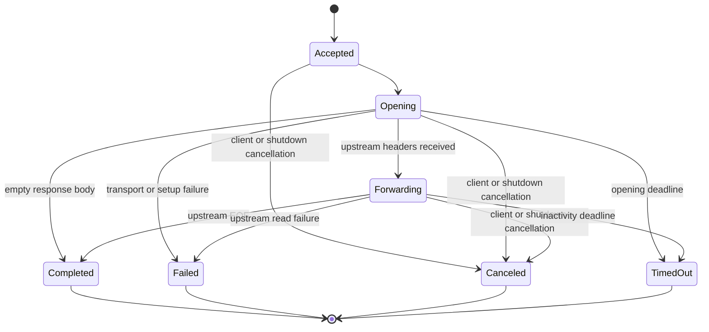

# SPEC E05 — Execution

Status: approved by the developer on 2026-10-31.

Date: 2026-10-31.

Workflow stage: approved SPEC; Phase 3 — Review and Phase 4 — Design completed.
Phases 5–7 are authorized under the project SDD workflow. The project lead
subsequently authorized one local commit on 2026-10-31. Push and publication
remain unauthorized.

## 1. Objective

Introduce an in-process execution lifecycle for each admitted
`POST /v1/responses` request. E05 coordinates one explicit execution target with
the existing provider adapter, controls the response stream and cancellation,
classifies terminal outcomes, and closes execution resources deterministically.

E05 must preserve the current HTTP boundary, upstream response semantics, and
E02 byte-for-byte request passthrough. It must remain usable without E08 or E09.
The Execution Manager does not classify intent, choose a provider or model,
evaluate eligibility, apply business policy, or retry an execution.

## 2. Discovery context and baseline

The repository is a Go 1.23 local-first modular monolith with an explicit
application lifecycle and no database, queue, or external runtime service.
`cmd/ai-hub` constructs the OpenCode Go client and injects it directly into the
Responses handler. The handler currently opens the upstream request, copies the
response in chunks, flushes it, and handles inactivity and client disconnects.
There is no logical execution object, active-execution registry, or terminal
outcome contract.

E04 access middleware authenticates and admits requests before dispatch. It
bounds and buffers accepted request bodies, validates media type and session
metadata, and keeps request correlation separate from provider session context.
That layer remains the security and admission boundary; E05 consumes its
accepted request context and metadata.

The provider package is a concrete OpenCode Go adapter. E02 deliberately deferred
generic provider abstractions until a second provider exists. The catalog is
derived metadata: it records provider model declarations and leaves execution
verification unverified. Catalog freshness or provider health is not proof that
a particular execution will succeed.

Existing time bounds are distinct:

| Bound | Current behavior |
| --- | --- |
| TCP dial and TLS handshake | 10 seconds each |
| Waiting for upstream response headers | 120 seconds (`ResponseHeaderTimeout`) |
| Silence between streamed body reads | 2 minutes, re-armed per chunk |
| HTTP response write deadline | 30 seconds by default; streaming re-arms a 2-minute inactivity deadline through `ResponseController` |
| Total execution duration | No total cap; progressive streams may continue while chunks arrive |
| Application shutdown | Configurable, 10 seconds by default |

ADR-008 intentionally defines inactivity rather than a total stream duration.
E05 preserves this rule and does not add an arbitrary total timeout.

## 3. Scope

### 3.1 In scope

- One logical execution for each request admitted to execution.
- An Execution Manager that owns execution registration, derived context,
  upstream response-body ownership, terminal outcome, and active-operation
  shutdown coordination.
- Coordination between the HTTP Gateway and the existing OpenCode Go adapter.
- Progressive response streaming without buffering the complete upstream body.
- Distinct handling for caller cancellation, shutdown cancellation, opening
  timeout, streaming inactivity timeout, transport failure, and upstream read
  failure.
- Deterministic closure of the upstream body and joining of execution-owned
  reader work before terminal completion is published.
- Structured lifecycle logs correlated with the existing request ID. Logs must
  not contain request bodies, provider credentials, or generated content.
- An explicit target-plus-payload command contract suitable for a future caller
  that has already resolved a destination.

### 3.2 Out of scope

- Task classification, model selection, intelligent routing, or provider
  selection decisions.
- Policy Engine, eligibility, quotas, budgets, permissions, cost calculation,
  usage persistence, or user-specific authorization.
- Automatic retries, fallback, provider switching, or mid-stream recovery.
- Durable execution history, durable sessions, conversation persistence, or
  Learning Engine behavior.
- A second provider, generic protocol translation, or a speculative
  multi-provider framework.
- Catalog changes, Dashboard, metrics subsystem, or OpenTelemetry export.
- Changing E01–E04 contracts or refactoring their unrelated technical debt.

## 4. Component boundaries

| Component | E05 responsibility |
| --- | --- |
| `internal/access` | Remains the E04 authentication, request-admission, and request/session identity boundary. E05 does not duplicate it. |
| `internal/gateway` | Remains the HTTP boundary: route/method handling, local HTTP errors, selected response headers, status commitment, client writes, and flushing. It delegates execution lifecycle to the manager. |
| `internal/execution` | Owns the logical execution, cancellation arbiter, upstream body lifecycle, stream coordination, terminal result, and active-execution drain. It makes no routing or policy decision. |
| `internal/providers` | Retains OpenCode Go URL, credential, transport, and upstream protocol responsibilities. It does not own HTTP client identity or business policy. |
| `internal/catalog` | Remains read-only model metadata. It does not decide whether a model is eligible or guaranteed to execute. |
| `internal/app` / `cmd/ai-hub` | Compose lifecycle and ensure the server stops accepting work before active executions are canceled and the provider client is released. Exact wiring is a Design decision. |

Execution flow:

```text
Client -> E04 access/admission -> HTTP Gateway -> Execution Manager
                                                -> OpenCode Go adapter -> upstream
Client <- HTTP Gateway <- progressive response <- Execution Manager
```

The manager may use a narrow execution seam for tests, but E05 does not require
a general provider interface. Existing fake-upstream HTTP tests remain a valid
test seam.

## 5. Execution Target and Request Payload

These are distinct values in the internal execution command:

- **Execution Target** identifies the already-resolved provider and, when
  available, model. It is routing input, not a routing decision.
- **Request Payload** is the provider-ready Responses request. E05 treats it as
  opaque and does not parse, normalize, serialize, or rewrite it.

The internal command contract is:

```text
ExecutionCommand
  request_id             correlation parent from E04
  target.provider_id     explicit adapter destination
  target.model_id        requested/resolved model identifier when available
  provider_session_id    E04 provider context; not a durable AI Hub session
  request_payload        accepted provider-ready payload, unchanged by E05
  content_type           accepted request media type
```

`request_id` and `provider_session_id` retain the meanings established by
ADR-013. The manager creates a separate internal `execution_id`; it is not a
public header and is not persisted. An attempt ID is not needed while retries
are excluded.

### 5.1 Construction and validation

For the current route, composition supplies `provider_id = opencode-go`, the
only configured adapter. The current requested model remains part of the
provider-ready payload. If the Gateway extracts a model identifier for target
metadata, extraction must be read-only and must not reject or alter a payload
that E02 previously forwarded to the provider. The model identifier may
therefore be absent from target metadata on this legacy passthrough path; the
provider remains authoritative for payload validation.

The Execution Manager validates command structure: `provider_id` must be
non-empty and resolve to a configured adapter; a supplied `model_id` must be
non-empty. The legacy passthrough path may omit `model_id` when it cannot be
extracted without changing E02 behavior; in that case the payload remains the
provider's source of truth. A future resolved command from E08 must carry both
identifiers. The component preparing a future routed payload is responsible for
ensuring its model field matches the target. The Execution Manager does not
inspect payload bytes to make that determination. The provider adapter validates
only the provider/model identity constraints it owns; it does not consult the
catalog to make an eligibility decision. Future E09 policy code owns business
eligibility; future E08 code owns model selection.

The manager passes target and payload together to the adapter. For the E05
passthrough path, the adapter sends the payload bytes unchanged; target metadata
does not silently overwrite a payload field. A future selected model may differ
from the model encoded in an incoming payload. Supporting that case requires an
explicit Responses request-preparation/mapping contract that produces a
provider-ready payload for the selected target. That mapping is outside the
Execution Manager and must be specified and approved with the E08 integration
before it is enabled. E05 itself neither performs nor assumes that rewrite.

This separates E05's stable responsibility—execute an explicit target and
prepared payload—from the future decision about where protocol-specific target
mapping belongs. The mapper's package ownership remains a future E08 integration
decision;
it must not be resolved by silently changing E02 passthrough.

## 6. Lifecycle and terminal results

Execution states:



| State/result | Meaning |
| --- | --- |
| `accepted` | E04 admitted the request and the manager atomically registered it. |
| `opening` | The adapter is opening the upstream request and waiting for response headers. |
| `forwarding` | Upstream response metadata is committed and the body is being forwarded. |
| `completed` | Upstream body reached EOF and execution-owned resources were closed. An upstream HTTP `4xx` or `5xx` can still be a completed transport exchange; its original status is retained separately. |
| `failed` | Transport setup or upstream body read failed for a reason other than a classified timeout or cancellation. |
| `canceled` | Client/request cancellation or application shutdown canceled the execution. Cause is retained as `client` or `shutdown`. |
| `timed_out` | An opening deadline or stream inactivity deadline expired. The timeout phase is retained. |

Terminal states are immutable. Exactly one terminal result wins. For competing
timeout, cancellation, EOF, and provider-failure signals, one synchronized
terminal arbiter reserves the first observed terminal event. The winner
determines the final result; losing signals may be recorded as secondary
diagnostics but cannot change it. Resource cleanup and reader joining happen
before the reserved result is published as terminal.

## 7. Cancellation, concurrency, and resource ownership

### 7.1 Cancellation semantics

| Trigger | Cancellation requester | Execution effect |
| --- | --- | --- |
| Client disconnect / request context canceled | HTTP request context and Gateway write failure | Signal the reader to stop, cancel the derived upstream context, close the upstream body, discard pending chunks, join the reader, then record `canceled(client)`. No replacement response is attempted after disconnection. |
| Application shutdown begins | Shutdown coordinator | Atomically close the manager's admission gate and begin draining registered executions. |
| Drain deadline expires | Shutdown coordinator / manager | Cancel every remaining execution with cause `shutdown`, signal readers to stop, close upstream bodies, discard pending chunks, join reader work, and record `canceled(shutdown)`. |
| Opening deadline expires | Execution timeout coordinator | Cancel the upstream context and record `timed_out(opening)`; before response headers, the Gateway may still return a local timeout response. |
| Stream inactivity expires | Execution timeout coordinator | Signal the reader to stop, cancel the upstream context, close the body, discard pending chunks, join the reader, and record `timed_out(inactivity)`. If HTTP response metadata was committed, only terminate the stream. |
| Upstream body read error | The execution reader reports the error | Stop forwarding, close/join resources, and record `failed(upstream_read)`. |
| Client write/flush error | Gateway sink reports the write failure | Treat as client cancellation, cancel upstream, close/join resources, and record `canceled(client)`. |

The manager owns the derived execution context and cancellation cause. After a
successful provider response, it owns the upstream response body and the sole
read loop. The Gateway owns `http.ResponseWriter`; it supplies the manager with
a chunk sink that writes and flushes HTTP bytes. Once a terminal event wins, no
additional chunk is sent to the sink. No component may start a body read after
closure. A read already blocked when cancellation closes the body must return;
the reader must be joined before the execution is declared terminal.

### 7.2 Concurrency invariants

1. Registration and the `accepting` check are atomic: shutdown cannot race a
   `Wait` against a later execution registration.
2. Each admitted execution is registered once and removed once.
3. Client cancellation, shutdown, timeout, response completion, and provider
   failure compete through one terminal arbiter; only one may finalize state.
4. Cancellation request, upstream cancellation, resource closure, and terminal
   result are distinct events. A cancellation request alone does not claim
   cleanup is complete.
5. One owner closes the upstream body. Closure is idempotent and the reader is
   joined before active registration is removed.
6. After terminal state publication, no state or result field changes.
7. During draining, no new execution reaches the provider. Requests already
   inside the HTTP server but not registered by the manager receive a generic
   `503 Service Unavailable` Gateway error with type `execution_unavailable`.

The implementation mechanism—mutex/active registry, per-execution coordinator,
once/CAS finalization, or a combination—is reserved for Design. The SPEC
requires the invariants, not a prescribed synchronization primitive.

## 8. Timeouts and HTTP error taxonomy

| Condition | Terminal classification | HTTP behavior |
| --- | --- | --- |
| Network/transport failure before response headers (including dial or TLS failure, excluding a classified response-header deadline) | `failed(transport)` | `502 Bad Gateway`, preserving E02 transport-error behavior. |
| Local deadline waiting for upstream response headers | `timed_out(opening)` | `504 Gateway Timeout` with generic `execution_timeout` before response commitment. |
| Upstream responds with `4xx` or `5xx` | Response forwarded; terminal result follows body completion | Preserve original status, permitted headers, and body. Do not replace with a local error. |
| Inactivity between body chunks | `timed_out(inactivity)` | If response metadata is already committed, close the stream and log the terminal result; do not write a JSON error afterward. |
| Client disconnect / request context cancellation | `canceled(client)` | Cancel upstream and clean up; no local response is attempted after disconnect. |
| Manager is draining and a request has not registered | No execution created | `503 Service Unavailable` with generic `execution_unavailable`; use the Gateway's safe local error envelope. |
| Shutdown drain deadline expires | `canceled(shutdown)` | Cancel upstream and clean up; no new execution is accepted. |
| Upstream body read error after response commitment | `failed(upstream_read)` | End the stream; do not replace a partial response. |
| Gateway write failure | `canceled(client)` | Cancel upstream and clean up. |

The HTTP response is considered committed when the Gateway writes upstream
status/headers, not when the first body chunk arrives. Thus an inactivity
timeout after metadata commitment cannot become a local `504` even if no body
chunk was delivered.

E02 currently maps all errors returned while opening Responses to `502`. The
approved `504` for a recognized local response-header deadline is a deliberate,
narrow behavior change; ordinary transport failures remain `502`, and upstream
responses remain untouched. The project lead explicitly approved this change
on 2026-10-31. No other E01–E04 error contract changes.

No total timeout is introduced. Existing connection, response-header, and
inactivity bounds remain separate and the stream may exceed any one fixed total
duration while making progress, as ADR-008 specifies.

## 9. Shutdown and draining

Shutdown must satisfy this semantic sequence:

1. Coordinate listener shutdown with closure of the Execution Manager's
   registration gate. Gate closure is atomic with respect to execution
   registration; requests racing the listener transition that reach the closed
   gate receive `503 execution_unavailable`.
2. Allow already registered executions to finish within the configured drain
   period.
3. When that period expires, request shutdown cancellation for every remaining
   execution, cancel its upstream context, and close its response body.
4. Join execution-owned reader work and publish one immutable terminal result
   before releasing provider resources.
5. Return a shutdown error if cleanup cannot be confirmed; never report a clean
   stop while executions or execution-owned goroutines remain active.

The current server's `Shutdown` can consume the full shared deadline while
waiting for active HTTP handlers, and the current provider stop only closes
idle connections. Therefore the implementation coordinates the drain gate,
server shutdown, cancellation at deadline, join, and provider stop as one
lifecycle. ADR-015 records the coordinator and cleanup-window allocation; the
required externally observable sequence above remains fixed by this SPEC.

## 10. Compatibility requirements

- Preserve E04 authentication, Host/Origin rules, body limit, media type,
  session grammar, request ID, and local access-error behavior.
- Preserve E02 request payload bytes in the E05 passthrough path.
- Preserve progressive SSE/Responses delivery and upstream status/body
  passthrough; do not buffer complete responses.
- Preserve existing provider-unavailable behavior (`503`).
- Keep `X-Request-Id` as correlation only and provider session as non-durable
  provider context.
- Do not use catalog `listing_state=current` or provider health as execution
  success/eligibility guarantees.
- The approved public error change is `504 execution_timeout` for a recognized
  local opening timeout; transport failures remain `502` and upstream responses
  are preserved.

## 11. E08, E09, and E06 dependencies

- **E05 → E09:** E05 supplies a target and execution result. E09 later supplies
  eligibility, permissions, quotas, and budget constraints before execution;
  none are enforced by E05.
- **E09 → E08:** E09 defines the allowed target set and limits. E08 classifies
  intent and chooses a destination only from what E09 allows. E08 and E09 must
  agree on the target contract before automatic selection is enabled.
- **E08 → E05:** E08 supplies an already resolved target and a provider-ready
  payload. E05 executes exactly that command and does not reconsider it.
- **E05 → E06:** E05 exposes execution ID, request correlation, provider/model
  identity when known, terminal outcome, upstream status, and duration for
  later usage/observability work. E05 persists none of these.
- E05 continues to serve the existing direct OpenCode Go route when E08/E09 are
  absent. E09's per-user permissions may require a future E04 identity expansion;
  the current static gateway principal must not be presented as per-user
  identity.

Recommended roadmap dependency: keep E05 before E08/E09; deliver E09's
eligibility/limits contract before enabling E08 automatic selection, even if
classification work in E08 proceeds independently. Keep E06 responsible for
recording usage/results and E07 responsible for harness-level validation.

## 12. Risks and mitigations

| Risk | Mitigation in E05 |
| --- | --- |
| Races among timeout, disconnect, EOF, and provider failure | One synchronized terminal arbiter; concurrency tests force each event ordering. |
| Reader goroutine or body remains live after cancel | Single read owner; close unblocks read; join before terminal publication; tests assert `readerDone`, body close count, and request-context cancellation. |
| Shutdown deadline is consumed by HTTP draining before execution cleanup | Close the manager gate before server drain; cancel at the deadline, force-close active HTTP connections, join execution work, and guard provider release as recorded in ADR-015. |
| Partial response cannot be replaced with a local error | Commit status once, then terminate stream and record internal outcome only. |
| `504` changes E02's current error status | The developer approved this narrow change for recognized response-header deadlines; ordinary transport errors remain `502`. |
| Future model selection conflicts with opaque byte-preserving payload | Keep target and payload separate; require an explicit, separately approved protocol-mapping step before E08 may change the model field. |
| Catalog data is stale or merely declarative | E05 does not infer execution eligibility or success from catalog state. |
| Concurrent request memory use | Preserve E04's per-request body bound; concurrency quotas remain E09 scope. |
| Gateway key/session/request ID confusion | Preserve ADR-013 meanings; generate a distinct internal execution ID and never log credentials or payload. |

External dependency: real E2E validation needs an available OpenCode Go service
and private provider credential. Automated lifecycle tests use the standard
library fake HTTP server and require no new dependency.

## 13. Acceptance criteria

1. Each request admitted to execution creates exactly one logical execution;
   requests rejected by E04 or by the manager's closed drain gate create none.
2. Each execution has one internal execution ID and exactly one immutable
   terminal result.
3. Client/request cancellation reaches the provider request context and closes
   the upstream response body.
4. The execution-owned reader stops initiating reads after cancellation/body
   closure and is joined before terminal publication.
5. A shutdown transition prevents new provider calls, rejects unregistered
   in-flight HTTP requests with `503 execution_unavailable`, drains current
   executions for the configured period, then cancels and joins remaining
   execution work before provider resources are released.
6. Opening timeout, stream inactivity, transport failure, client cancellation,
   and shutdown cancellation have distinct terminal classifications.
7. A recognized local response-header deadline returns `504 execution_timeout`
   before response commitment.
8. Connection/communication failures before response commitment return `502`.
9. Upstream `4xx`/`5xx` status and body are preserved; no local envelope replaces
   them.
10. Response chunks are delivered progressively; the complete response is never
    buffered by E05.
11. E02 request bytes and E04 admission/authentication behavior remain unchanged
    on the passthrough path.
12. The Execution Manager consumes an explicit target and prepared payload but
    contains no task classification, model/provider choice, eligibility, or
    business-policy decision.
13. E05 performs no automatic retry, fallback, model switch, persistence, or
    durable session handling.
14. Concurrent tests under `go test -race` force competing cancellation,
    timeout, EOF, provider read failure, and shutdown orderings; no result is
    finalized twice.
15. Tests observe upstream context cancellation, exactly-once body closure,
    reader completion, active-registry drain, and no test-owned goroutine left
    running.
16. Existing E01–E04 regression tests and a real Codex CLI/OpenCode Go E2E pass
    without credential or payload leakage.

## 14. Validation plan and evidence

- Unit tests for terminal arbitration, state immutability, target structure,
  active registration, and drain-gate races.
- Fake-upstream tests for connection failure, response-header timeout,
  upstream `4xx`/`5xx`, progressive chunks, inactivity timeout, body read error,
  client disconnect, writer failure, and shutdown deadline.
- Deterministic resource assertions: body close count is one; upstream request
  context is canceled; the execution reader signals completion; active
  executions return to zero. Run these under `go test -race`.
- Claim-scoped evidence: `go test ./internal/execution/... ./internal/gateway/... ./internal/providers/... -race`, followed by `go test ./... -count=1 -race`, `go vet ./...`, `staticcheck ./...`, `golangci-lint run ./...`, formatting, and `go build ./...`.
- Opt-in real E2E with Codex CLI and OpenCode Go validates progressive streaming,
  upstream error passthrough, cancellation where observable, and the approved
  local timeout contract. Secret values remain redacted.

No tests or runtime validation were run during Discovery refinement. The
post-approval implementation evidence is:

- **Phase 5 — Red:** `TestResponsesHandlerMapsHeaderTimeoutTo504` demonstrated
  the pre-implementation mismatch: the handler returned `502` where the
  approved response-header timeout contract requires `504`. During the Phase 6
  self-review, `TestResponseSinkReturnsFlushError` also failed against the
  implementation because the Gateway ignored the writer's flush error; the
  sink was corrected to propagate that error. Phase 7 review then identified a
  race between terminal reservation and response metadata commitment.
  `TestResponseCommitSerializesWithTerminalArbitration` failed because the
  terminal arbiter was unlocked while the Gateway had not yet committed its
  headers; the commit path was synchronized and the regression test now passes.
- **Phase 6 — Green:** focused lifecycle/gateway/provider/app tests passed under
  `-race` (88 tests across four packages), and `go test ./... -count=1 -race`
  passed (479 tests across 11 packages). `go vet ./...`, `staticcheck ./...`,
  `golangci-lint run ./...`, `go build ./...`, `gofmt -d`, and `git diff --check`
  passed. Coverage was 87.7% for `internal/execution`, 92.3% for
  `internal/gateway`, 92.5% for `internal/providers`, and 85.7–100% across the
  functions in the new `cmd/ai-hub/lifecycle.go` file. The broader
  `cmd/ai-hub` package reports 28.4% because its existing bootstrap path is not
  exercised by these focused lifecycle tests.
- **Real E2E:** isolated Codex CLI 0.164.0-alpha.11.1 completed a request through
  the local Gateway to OpenCode Go using `deepseek-v4.1-flash` and returned the
  expected `E05_E2E_OK` marker. The temporary Codex home, Gateway key, and
  catalog directory were removed; the project `.env` and global Codex
  configuration were not modified. Provider and Gateway credentials were
  absent from Gateway logs.
- **Security scan limitation:** the Snyk Code scan could not run because the
  connected organization does not have Snyk Code enabled (`SNYK-CODE-0005`);
  its activation request returned `404`. No Snyk result is claimed.

Phase 7 independent review completed in Round 2 with verdict `APPROVED` and no
remaining critical, important, or minor findings. The Round 1 terminal/commit
race was corrected and verified by `TestResponseCommitSerializesWithTerminalArbitration`
under `-race`. The Snyk Code limitation remains as recorded above; no SAST
result is claimed. No commit, push, or publication had occurred when the
validation and review evidence was compiled. The project lead subsequently
authorized one local commit on 2026-10-31; push and publication remain
unauthorized.

## 15. Design decisions and ADRs

The Phase 4 design is recorded in the following accepted ADRs:

- [ADR-014 — Execution lifecycle and command contract](../adr/ADR-014-execution-lifecycle-and-command-contract.md)
  defines the manager, explicit target-plus-payload command, stream ownership,
  terminal publication, and logging boundary.
- [ADR-015 — Coordinated execution shutdown](../adr/ADR-015-coordinated-execution-shutdown.md)
  defines lifecycle composition, gate closure, graceful drain, forced
  cancellation, reader joining, and provider-stop protection.
- [ADR-016 — Execution timeout and HTTP error mapping](../adr/ADR-016-execution-timeout-and-error-mapping.md)
  distinguishes the response-header deadline from other transport failures and
  preserves post-commit stream semantics.

Implementation sequence:

1. Add target-aware provider opening and typed response-header-timeout
   classification while retaining the existing provider passthrough behavior.
2. Add execution command, terminal result, registration gate, arbiter, body
   ownership, reader join, drain coordination, and focused unit tests.
3. Replace the gateway's direct provider call and reader loop with command
   construction and a response-writing sink; retain the existing local error
   envelope and upstream `Content-Type` handling.
4. Add forced active-connection closure to the server and compose server plus
   execution shutdown in `cmd/ai-hub`; guard provider release on confirmed
   execution cleanup.
5. Run claim-scoped tests, then the complete verification plan in §14, followed
   by the independent Phase 7 review. A local commit was subsequently
   authorized by the project lead; push and publication remain unauthorized.

Expected implementation files are `internal/execution/*`,
`internal/providers/client.go`, `internal/gateway/responses_handler.go`,
`internal/gateway/errors.go`, `internal/server/server.go`, and
`cmd/ai-hub/main.go` plus a focused lifecycle composition file if needed. Add
tests alongside the affected packages. No changes to E01–E04 specs or ADRs are
planned; server force-close and provider target-aware opening are limited to
the approved E05 lifecycle and command contracts.

## 16. Decision register

| Decision | Approved position | Status |
| --- | --- | --- |
| Execution Manager responsibilities | Execute explicit target and prepared payload; own lifecycle only | Approved; preserve as implementation constraint |
| Target/payload handling | Separate values; E05 payload remains opaque and unchanged; future mapping is an explicit protocol boundary | Approved; mapper ownership remains a Design decision for future integration |
| Internal execution ID | Distinct from request ID and provider session; in-memory only | Approved |
| Terminal race arbitration | First terminal event linearized by one synchronized arbiter wins; result is immutable | Approved; mutex-based reservation and publish-after-join are recorded in ADR-014 |
| Total execution timeout | None; preserve ADR-008 progress-based stream lifetime | Preserved decision from ADR-008 |
| Opening timeout HTTP status | `504` for recognized response-header deadline; transport errors remain `502` | Explicitly approved on 2026-10-31 |
| Shutdown gate response | `503 execution_unavailable` for requests that reach the closed manager gate | Explicitly approved on 2026-10-31 |
| Upstream error responses | Preserve provider status/body | Existing E02/E04 contract; preserved |
| Retries/fallback | Excluded from E05 | Approved scope boundary |
| Shutdown | Gate new executions, drain, cancel at deadline, close/join before provider release | Approved; lifecycle coordination and provider-stop guard are recorded in ADR-015 |
| E08/E09 dependency | E09 eligibility constrains E08 selection; E05 executes the resolved command | Approved roadmap dependency |

## 17. SDD sequence and Evidence block

Phase 3 SPEC review is complete with no scope or acceptance-criteria changes.
Phase 4 Design is recorded in accepted ADR-014 through ADR-016. The project
lead approved this SPEC on 2026-10-31, including its scope, contracts,
invariants, acceptance criteria, and the explicit `504 execution_timeout` and
`503 execution_unavailable` behaviors. That approval authorizes continuation
through Phase 5 failing tests, Phase 6 implementation and claim-scoped
validation, and Phase 7 independent review. A subsequent project-lead
instruction on 2026-10-31 authorizes one local commit; it does not authorize a
push or publication.

- **Claim:** Every admitted Responses execution reaches one terminal result
  after upstream resources and reader work are closed, while preserving the
  approved target, payload, error, and streaming contracts.
- **Success type:** `test` and `manual`.
- **Evidence path:** Deterministic fake-upstream and race tests for lifecycle,
  timeout, cancellation, stream, and shutdown boundaries; full Go quality gates;
  opt-in Codex CLI/OpenCode Go E2E for end-to-end passthrough and streaming.
- **Budget:** Focused execution/gateway/provider tests plus full regression and
  one real E2E run; verify body close count, request-context cancellation, reader
  join, active count zero, terminal count one, and redacted logs.
- **Affordance:** Test-only controlled upstream and reader completion signals,
  if existing injection seams cannot expose closure and join state. No durable
  execution store is required.

## 18. Approval record

- **Approved by:** Project lead.
- **Date:** 2026-10-31.
- **Approved scope:** E05 responsibilities, component boundaries, target and
  payload contracts, lifecycle, cancellation, concurrency invariants, shutdown
  semantics, exclusions, dependencies, and acceptance criteria in this SPEC.
- **Phase 3 review outcome:** The SPEC and Evidence block were complete and
  consistent with the approved scope. The review corrected stale approval and
  phase-status wording without changing requirements or acceptance criteria.
- **Explicit HTTP behavior approvals:** A recognized local response-header
  timeout returns `504 Gateway Timeout` with code `execution_timeout`; requests
  reaching the Execution Manager after its drain gate closes receive
  `503 Service Unavailable` with code `execution_unavailable`.
- **Execution authorization:** Continue through the mandatory SDD workflow,
  including Design, TDD Red, implementation, verification, and independent
  review. No additional approval is required for ordinary phase transitions.
- **Commit authorization:** A subsequent project-lead instruction on
  2026-10-31 authorizes one local commit documenting the completed E05 work.
- **Publication boundary:** Push and publication remain unauthorized.

## References

- [`docs/architecture.md`](../architecture.md)
- [`docs/specs/E02-provider-management.md`](E02-provider-management.md)
- [`docs/specs/E03-model-catalog.md`](E03-model-catalog.md)
- [`docs/specs/E04-gateway-hardening-access-control.md`](E04-gateway-hardening-access-control.md)
- [`docs/adr/ADR-008-streaming-inactivity-deadline.md`](../adr/ADR-008-streaming-inactivity-deadline.md)
- [`docs/adr/ADR-009-model-catalog-identity-and-semantics.md`](../adr/ADR-009-model-catalog-identity-and-semantics.md)
- [`docs/adr/ADR-012-request-admission-and-local-errors.md`](../adr/ADR-012-request-admission-and-local-errors.md)
- [`docs/adr/ADR-013-request-and-session-identity.md`](../adr/ADR-013-request-and-session-identity.md)
- [`docs/adr/ADR-014-execution-lifecycle-and-command-contract.md`](../adr/ADR-014-execution-lifecycle-and-command-contract.md)
- [`docs/adr/ADR-015-coordinated-execution-shutdown.md`](../adr/ADR-015-coordinated-execution-shutdown.md)
- [`docs/adr/ADR-016-execution-timeout-and-error-mapping.md`](../adr/ADR-016-execution-timeout-and-error-mapping.md)
- [`AI-Hub-Product-Architecture-Kickoff.md`](../../AI-Hub-Product-Architecture-Kickoff.md)
