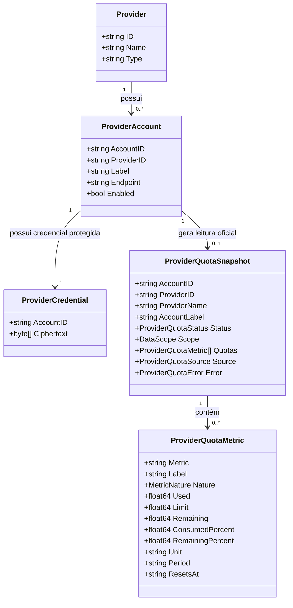

# Especificação Técnica (SPEC — Revisão 3): Unified Quota Management & Container de Consumo de Franquias

**Documento:** `docs/specs/FE-PROVIDER-QUOTA-CONSUMPTION.md`  
**Data da Revisão:** 2026-11-04  
**Status:** Alinhado com a Decisão de Produto de Unified Quota Management  
**Autores:** Engenharia Connexto AI Hub  
**Decisões de Produto Vinculadas:**  
- `docs/decisions/unified-quota-management.md`  
- `docs/decisions/provider-reported-quota-only.md`  
**Auditoria de Capacidade Vinculada:** [`docs/discovery/provider-reported-quota-audit-2026-11-04.md`](../discovery/provider-reported-quota-audit-2026-11-04.md)  

---

## 1. Visão Estratégica do Produto

O **Connexto AI Hub** centraliza a visibilidade e o monitoramento das franquias e consumo de **$N$ contas** distribuídas entre múltiplos provedores de IA em uma única plataforma operacional unificada.

A evolução da capacidade está estruturada em **duas etapas independentes**:

### ETAPA 1 — MVP: Unified Quota Management (Escopo Desta Entrega)
- **Objetivo**: Permitir que o operador acompanhe todas as suas contas cadastradas e respectivas franquias em uma única interface confiável.
- **Premissa Fundamental**: O AI Hub atua exclusivamente como **integrador, normalizador e apresentador**. A fonte da verdade é estritamente o próprio provedor. O Hub **não inventa** campos ausentes a partir de política interna, histórico de execução ou thresholds sintéticos. Apresentação derivada é permitida apenas quando ambos os operandos são campos oficiais do mesmo snapshot (fill de barra `used`/`limit` sem rótulo `%` inventado; `limit − used` quando `remaining` não veio no payload).
- **Regras Operacionais**:
  1. Descoberta dinâmica de todos os provedores e contas cadastrados.
  2. Suporte a **múltiplas contas para o mesmo provedor** (ex: duas ou mais contas OpenRouter para diferentes times ou projetos).
  3. Consulta concorrente e independente para cada conta.
  4. Utilização exclusiva de APIs oficiais disponíveis.
  5. Preservação estrita do escopo da informação (`api_key`, `account`, `workspace`, `organization`).
  6. Preservação de valores originais, unidades monetárias/tokens, ciclos e timestamps.
  7. Identificação transparente de contas sem suporte oficial de consulta (`Sem leitura`).
  8. Isolamento de falhas: uma falha em uma conta jamais impede ou bloqueia a visualização das demais.
  9. Atualização sob demanda e manual (sem polling em background).
  10. Nenhuma inferência a partir de política Hub, execução histórica ou thresholds; apresentação aritmética limitada a fill visual `used`/`limit` e `limit − used` com operandos oficiais.
  11. **Nenhuma implementação de inteligência ou roteamento automático nesta etapa.**

### ETAPA 2 — Intelligence & Automatic Routing (Etapa Futura Independente)
- **Objetivo**: Utilizar as leituras oficiais centralizadas na Etapa 1 como sinais para decisões dinâmicas de roteamento.
- **Capacidades Futuras**: Interpretação de disponibilidade de contas, seleção automática de conta/provedor, estratégias de prioridade, balanceamento, fallback automático e explicabilidade das decisões.
- **Governança**: A Etapa 2 terá especificação técnica, critérios de aceitação e ciclo de validação próprios. **É expressamente vedado antecipar funcionalidades, thresholds ou heurísticas da Etapa 2 durante o MVP da Etapa 1.**

> [!CRITICAL]
> **Diretriz Definitiva de Produto:**  
> Primeiro centralizamos e tornamos confiáveis as informações das $N$ contas. Depois utilizamos essas informações para inteligência e roteamento automático. Não misturar as duas responsabilidades nem criar cálculos artificiais para antecipar a segunda etapa.

---

## 2. Modelo Conceitual do Domínio

A arquitetura estabelece a distinção clara entre cinco entidades de domínio:



1. **Provider**: O fornecedor de IA (ex: OpenRouter, OpenAI, Anthropic).
2. **Provider Account**: Uma conta específica cadastrada pelo operador no Hub (ex: `openrouter-principal`, `openrouter-secundaria`). Cada conta possui identificador único, nome amigável e status de ativação.
3. **Provider Credential**: O segredo de autenticação (Bearer Token, API Key) encriptado com AES-GCM e vinculado à conta.
4. **Provider Quota Snapshot**: A captura oficial normalizada do estado de franquia retornado para aquela conta em um determinado instante.
5. **Provider Quota Metric**: Uma métrica individual reportada pela conta, preservando sua natureza (`quota`, `usage`, `cost`, `rate_limit`), unidade e período.

---

## 3. Taxonomia e Separação de Capacidades

### 3.1. Natureza da Métrica (`MetricNature`)
- **`quota`**: Limites contratuais de crédito ou cotas concedidas/configuradas para consumo (ex: `limit`, `limit_remaining`).
- **`usage`**: Volume acumulado de utilização em quantidade de requisições ou tokens (ex: `usage_daily`, `free_model_daily_requests.used`).
- **`cost`**: Custo financeiro acumulado em moeda corrente (ex: `usage` em créditos USD).
- **`rate_limit`**: Limites operacionais de vazão por unidade de tempo (ex: requisições/minuto, tokens/minuto). *Não são exibidos como franquia.*

### 3.2. Escopo dos Dados (`DataScope`)
- **`api_key`**: A métrica restringe-se à chave individual da conta.
- **`account`**: A métrica refere-se à conta cadastrada no provedor.
- **`workspace`**: A métrica refere-se ao workspace ou projeto compartilhado.
- **`organization`**: A métrica refere-se à organização global.
- **`subscription`**: A métrica refere-se ao plano/contrato.
- **`unknown`**: Escopo não explicitado pelo provedor.

---

## 4. Auditoria de Capacidades Oficiais por Provedor

### 4.1. OpenRouter (`GET https://openrouter.ai/api/v1/key`)
- **Referência Oficial**: [OpenRouter API Reference — Get current key](https://openrouter.ai/docs/api/api-reference/api-keys/get-current-key)
- **Escopo**: `api_key` (chave da conta autenticada).
- **Mapeamento Oficial**:
  - `usage` (cost, USD)
  - `limit` (quota, USD ou `null`)
  - `limit_remaining` (quota, USD ou `null`)
  - `limit_reset` (period/frequência, string ou `null`)
  - `usage_daily`, `usage_weekly`, `usage_monthly` (cost/usage, USD)
  - `byok_usage`, `byok_usage_daily`, `byok_usage_weekly`, `byok_usage_monthly` (cost BYOK, USD)
  - `is_free_tier` (flag de conta gratuita)
- **Regra de Renderização**: A API não envia campo percentual. Proibido inventar e rotular um percentual Hub-side. Apresentam-se os valores oficiais (`US$ X consumido · Limite US$ Y`). Quando `used` e `limit` oficiais existem no mesmo snapshot, a UI pode: (1) desenhar uma barra de progresso como fill visual de `used`/`limit` sem rótulo `%` inventado; (2) mostrar saldo disponível como `limit − used` se `remaining` não vier no payload.

### 4.2. Demais Provedores (OpenAI, Anthropic, OpenCode Go, Google AI, Azure OpenAI)
- **Anthropic**: Possui Usage & Cost API de relatórios administrativos de organização, mas **não** disponibiliza API de saldo em tempo real para chaves de inferência (`x-api-key`). Status: `unsupported` (`Sem leitura`).
- **OpenAI**: Possui Admin API de organização para custos, exigindo credenciais financeiras administrativas adicionais (`api.admin`). Chaves de projeto padrão (`sk-...`) recebem HTTP 401/403 e não possuem rota de saldo em tempo real. Status: `unsupported` / `unauthorized` (`Sem leitura`).
- **OpenCode Go, Google AI, Azure OpenAI**: Sem endpoints de saldo/franquia acessíveis via chave de inferência. Status: `unsupported` (`Sem leitura`).

---

## 5. Segurança dos Adapters e Validação de Rede

1. **Validação Rígida de Destino (`AIHUB_PROVIDER_ALLOWED_HOSTS`)**:
   - Requisições nunca são disparadas para endpoints arbitrários configurados por operadores.
   - O host é obrigatoriamente validado contra a allowlist (por padrão `openrouter.ai`, `opencode.ai`).
   - O `OpenRouterQuotaAdapter` ancora a rota estritamente em `https://openrouter.ai/api/v1/key`.
2. **Isolamento de Credenciais**:
   - Credenciais descriptografadas permanecem exclusivamente na memória volátil do backend durante a requisição e jamais são expostas em logs, payloads JSON ou no browser.
3. **Resiliência e Timeout**:
   - Timeout individual de 5 segundos por conta.
   - Conexão concorrente via goroutines isoladas com context cancellation.

---

## 6. Estados Semânticos da Leitura

- **`available`**: Dados oficiais obtidos com sucesso.
- **`unsupported`**: A integração não disponibiliza API pública oficial de franquia/saldo.
- **`unconfigured_credential`**: Conta cadastrada no Hub sem credencial configurada.
- **`unauthorized`**: Credencial rejeitada pelo provedor (HTTP 401 ou 403).
- **`rate_limited`**: Limite da API atingido na consulta da conta (HTTP 429).
- **`timeout`**: A consulta excedeu o tempo limite de 5 segundos.
- **`error`**: Falha não classificada na comunicação.

> [!NOTE]
> O estado `warning` (âmbar) somente é apresentado caso o provedor retorne explicitamente um indicador oficial de alerta em seu payload (ex: flag de quota excedida). É proibido acionar alertas com base em thresholds calculados pelo Hub (ex: 80%).

---

## 7. Contratos de Dados (DTOs)

### 7.1. Schema TypeScript (`apps/frontend/src/features/overview/api/types.ts`)

```typescript
export type ProviderQuotaStatus =
  | 'available'
  | 'unsupported'
  | 'unconfigured_credential'
  | 'unauthorized'
  | 'rate_limited'
  | 'timeout'
  | 'error'

export type DataScope =
  | 'api_key'
  | 'account'
  | 'workspace'
  | 'organization'
  | 'subscription'
  | 'unknown'

export type MetricNature =
  | 'quota'
  | 'usage'
  | 'cost'
  | 'rate_limit'

export interface ProviderQuotaMetric {
  metric: string
  label: string
  nature: MetricNature

  used?: number
  limit?: number
  remaining?: number

  consumedPercent?: number
  remainingPercent?: number

  unit?: string
  period?: string

  startsAt?: string
  endsAt?: string
  resetsAt?: string
}

export interface ProviderQuotaSource {
  type: 'provider_api'
  name: string
  scope: DataScope
  fetchedAt: string
  providerReportedAt?: string
}

export interface ProviderQuotaError {
  code: string
  message: string
}

export interface ProviderQuotaSnapshot {
  accountId: string
  accountLabel: string
  providerId: string
  providerName: string
  status: ProviderQuotaStatus
  scope: DataScope
  quotas: ProviderQuotaMetric[]
  source: ProviderQuotaSource
  error?: ProviderQuotaError
}

export interface ProviderQuotasResponse {
  snapshots: ProviderQuotaSnapshot[]
  fetchedAt: string
}
```

### 7.2. Estrutura Backend Go (`internal/providers/quota.go`)

```go
type ProviderQuotaStatus string

const (
	QuotaStatusAvailable              ProviderQuotaStatus = "available"
	QuotaStatusUnsupported            ProviderQuotaStatus = "unsupported"
	QuotaStatusUnconfiguredCredential ProviderQuotaStatus = "unconfigured_credential"
	QuotaStatusUnauthorized           ProviderQuotaStatus = "unauthorized"
	QuotaStatusRateLimited            ProviderQuotaStatus = "rate_limited"
	QuotaStatusTimeout                ProviderQuotaStatus = "timeout"
	QuotaStatusError                  ProviderQuotaStatus = "error"
)

type DataScope string

const (
	ScopeAPIKey       DataScope = "api_key"
	ScopeAccount      DataScope = "account"
	ScopeWorkspace    DataScope = "workspace"
	ScopeOrganization DataScope = "organization"
	ScopeSubscription DataScope = "subscription"
	ScopeUnknown      DataScope = "unknown"
)

type MetricNature string

const (
	NatureQuota     MetricNature = "quota"
	NatureUsage     MetricNature = "usage"
	NatureCost      MetricNature = "cost"
	NatureRateLimit MetricNature = "rate_limit"
)

type ProviderQuotaMetric struct {
	Metric           string       `json:"metric"`
	Label            string       `json:"label"`
	Nature           MetricNature `json:"nature"`
	Used             *float64     `json:"used,omitempty"`
	Limit            *float64     `json:"limit,omitempty"`
	Remaining        *float64     `json:"remaining,omitempty"`
	ConsumedPercent  *float64     `json:"consumed_percent,omitempty"`
	RemainingPercent *float64     `json:"remaining_percent,omitempty"`
	Unit             *string      `json:"unit,omitempty"`
	Period           *string      `json:"period,omitempty"`
	StartsAt         *string      `json:"starts_at,omitempty"`
	EndsAt           *string      `json:"ends_at,omitempty"`
	ResetsAt         *string      `json:"resets_at,omitempty"`
}

type ProviderQuotaSource struct {
	Type               string    `json:"type"`
	Name               string    `json:"name"`
	Scope              DataScope `json:"scope"`
	FetchedAt          string    `json:"fetched_at"`
	ProviderReportedAt *string   `json:"provider_reported_at,omitempty"`
}

type ProviderQuotaError struct {
	Code    string `json:"code"`
	Message string `json:"message"`
}

type ProviderQuotaSnapshot struct {
	AccountID    string                `json:"account_id"`
	AccountLabel string                `json:"account_label"`
	ProviderID   string                `json:"provider_id"`
	ProviderName string                `json:"provider_name"`
	Status       ProviderQuotaStatus   `json:"status"`
	Scope        DataScope             `json:"scope"`
	Quotas       []ProviderQuotaMetric `json:"quotas"`
	Source       ProviderQuotaSource   `json:"source"`
	Error        *ProviderQuotaError   `json:"error,omitempty"`
}

type ProviderQuotasResponse struct {
	Snapshots []ProviderQuotaSnapshot `json:"snapshots"`
	FetchedAt string                  `json:"fetched_at"`
}
```

---

## 8. Escopo de Implementação do MVP (Etapa 1)

1. **Domínio e Modelos em Go (`internal/providers`)**:
   - Definição dos tipos `ProviderQuotaSnapshot`, `ProviderQuotaMetric` e da interface `QuotaAdapter`.
2. **`OpenRouterQuotaAdapter`**:
   - Integração segura com `GET https://openrouter.ai/api/v1/key`.
   - Validação de host via `AIHUB_PROVIDER_ALLOWED_HOSTS`.
   - Mapeamento estrito dos 11 campos oficiais de consumo e cota.
   - Escopo `api_key`.
3. **Serviço de Consulta Concorrente (`ProviderQuotaService`)**:
   - Descoberta dinâmica de todas as contas cadastradas via `providers.Service.List`.
   - Consulta concorrente isolada (timeout de 5s por conta).
   - Tratamento de status `unconfigured_credential` e `unsupported` para contas sem integração oficial.
4. **Endpoint Seguro no Gateway**:
   - Registro da rota `GET /api/ui/providers/quotas`.
5. **Componente Frontend `OverviewProvidersPanel`**:
   - Renderização da lista de contas cadastradas com identificação clara de conta e provedor.
   - Exibição de valores e unidades oficiais (ex: `US$ 0,45 consumido · Limite US$ 100,00`).
   - Badge quadrado com iniciais em `Geist Mono` (`.picon`).
   - Apresentação transparente de `Sem leitura` para contas sem suporte.
   - Navegação direta para `/providers` via botão `Ver franquias ↗`.
6. **Suíte de Testes Automatizados**:
   - Testes unitários com fixtures da resposta real do OpenRouter.
   - Validação de não-cálculo de percentuais.
   - Testes de isolamento de falhas entre múltiplas contas.
   - Testes de renderização no frontend (Vitest).

---

## 9. Governança e Critérios de Conclusão

- A implementação da Etapa 1 só é considerada concluída quando cada dado exibido for diretamente rastreável à resposta oficial da respectiva conta do provedor.
- Não implementar inteligência ou roteamento automático nesta etapa.
- Não realizar commit ou push sem autorização explícita do operador.
